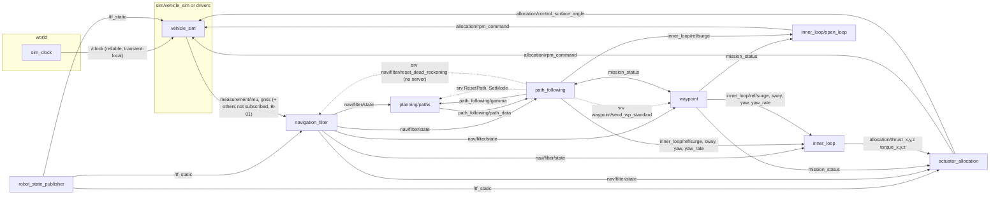

# Codebase Analysis — FAROL 2 — 2026-11-11

Branch `dev` at `3da51cf`. Confidence labels: **Confirmed** = reproduced in simulation, by a test/compile check, or by an unambiguous single-path code trace (the method is stated per finding); **Likely** = strong static evidence; **Possible** = worth a look, uncertain.

## Executive summary

- The stack builds and the simulator runs end to end, but three defects that cause unintended motion were reproduced in simulation. All three sit in code shared by the sim and real launches.
- **The navigation filter ignores its YAML on every vehicle** (B-01). The launch names the node `navigation_filter`, the YAMLs are keyed `filter_node`. The filter runs with built-in defaults (GNSS + IMU only, no plugins), so velocity, depth, altimeter and actuator fields of `NavigationState` are always zero. The surge PID then sees zero speed regardless of actual motion.
- **Nothing ever commands zero** (SAF-01). When references go stale or a mission is stopped, the inner loop and the allocation simply stop publishing. The last RPM command stays latched; in simulation the vehicle keeps thrusting indefinitely.
- **`wp_standard` always publishes surge 0.3** (B-02), including after arrival and for "hold position". Path following ends by calling this service, so every finished mission continues at 0.3 m/s (660 RPM open loop on `magicelectric`).
- No node detects stale navigation data (SAF-02), non-finite values propagate from a reference to the RPM command (SAF-03), and there is no e-stop path in this repository (SAF-04).
- Further correctness bugs: transposed rotation in `wp_heading` (B-03), swapped depth/altitude publishers in the console (B-04), `change_params` always edits the yaw controller (B-05), `config_to_use` ignored by five launch files (B-07).
- `farol2_console`'s HTTP server is unauthenticated on all interfaces and can publish to any topic (S-01). It is not started by `start_farol2.launch.py` today.
- Tests: 73 functional test cases exist, all in `farol2_utils` and `farol2_sim`; 72 pass. The control, navigation, allocation, guidance and planning packages have no functional tests. All `ament_lint` checks fail. There is no CI.
- Recommended first actions: fix B-01 (one line per YAML or launch), add a zero-command-on-timeout path in allocation (SAF-01), remove the hardcoded surge (B-02), then add nav staleness checks and gtest coverage for PID, allocation and waypoint math.

## Scope and method

**Analyzed:** all 12 packages (about 12k lines of C++, 1.6k of Python, 49 parameter YAMLs, 6 xacros, 12 launch files, the bash CLI). Read in full: `farol2_inner_loop`, `farol2_allocation`, `farol2_waypoint`, `farol2_nav` node + `sample_and_hold` + `current_estimator` + `yaw_rate_ekf`, `farol2_sim` node/actuators/sensors/launch utilities, `farol2_bringup`, the path-following node/services and the `Breivik` and `Ravi` algorithms, the planning node/services.

**Skimmed or skipped:** the other nine path-following algorithms (only grepped for I/O and clock use), path-section math in `farol2_planning`, `asv_dynamics_model.cpp`, `nav2console_state`, most of `console_server.py` (HTTP handler and topic-set path were read), CLI subcommands other than `kill-ros`/`clean`, `docs/`. The drivers repository (`farol2_drivers_bringup`) is external and was not analyzed, so any statement about real-vehicle actuator behaviour is conditional on it.

**Environment:** Ubuntu 24.04, ROS 2 Jazzy from a conda (RoboStack) environment with GCC 15.3 and Eigen 5.0.1, RMW Fast DDS. Build tree on `/scratch/evaristo/farol2_analysis_ws`. No source file was modified.

| Command | Result |
|---|---|
| `colcon build --cmake-args -DCMAKE_BUILD_TYPE=RelWithDebInfo` | **Failed** in `farol2_allocation`: `Eigen/Dense: No such file or directory` (see M-06) |
| same, with `CPLUS_INCLUDE_PATH=<env>/include/eigen3` | All 12 packages built; 56 warnings (54 `-Wunused-parameter`, 2 `-Wunused-variable`) |
| `colcon test` | gtest: 73 cases, 72 pass, 1 fail (`NotchFilterTest.RejectsInvalidParametersAndUsage`, B-16). `simulation_launch_policy` passes. Linters: about 1,750 failures across flake8, uncrustify, lint_cmake, pep257, xmllint in 8 packages |
| `g++ -fsyntax-only -Wfloat-conversion controller_pid.cpp` | Confirms integer `abs` (B-11) |
| Sim: world + `myellow` (domain 87), world + `magicelectric` (domain 88), scripted reference/waypoint experiments | Results quoted in B-01, B-02, B-08, SAF-01 |
| Dependency audit | Not run; no lockfile, dependencies come from the ROS distro |

## Findings

### Bugs

#### B-01 Navigation filter parameters are never loaded
- **Severity**: Critical
- **Confidence**: Confirmed (simulation, both vehicles)
- **Location**: `farol2_nav/launch/farol2_nav.launch.py:77`; `farol2_bringup/config/*/default/nav.yaml:5` (all six vehicles); defaults at `farol2_nav/src/filter_node.cpp:28-31`
- **What's wrong**: The launch starts the node as `name='navigation_filter'`. Every `nav.yaml` is keyed `filter_node:` under `/**:`, which matches no running node, so the file is ignored without any warning.
- **Impact**: The filter runs with `measurements=[gnss, imu]`, `filters=[]`. It does not subscribe to velocity, depth, altimeter, thruster RPM or rudder angle, and no plugin (`asv_dynamics_model`, `current_estimator`) runs on `magicelectric`. Consumers get zero for `velocity_through_water`, `velocity_over_ground`, `depth`, `altimeter`, `current_velocity_ned`. The surge, sway, heave, depth and altitude PIDs therefore regulate against a constant zero measurement; the surge integrator winds up toward `tau_max` for any non-zero reference. Applies equally to the real launch, which includes the same file.
- **Evidence**: `ros2 param get /myellow0/navigation_filter measurements` returned `['gnss', 'imu']`, `filters` returned `[]` (YAML lists seven measurements). With `surge_ref=0.5` for 8 s, sim truth was `sim/body_velocity.x = 0.516` while `nav/filter/state` reported `velocity_through_water.x = 0.0`, `depth = 0.0`, `thruster_rpm = []`, and `thrust_x` was still ramping (9.0 N, then 9.95 N).
- **Suggested fix**: Make the names agree (rename the launch `name` to `filter_node`, or rekey the six YAMLs). Then make the mismatch impossible to miss: drop the defaults in `load_params()` so a missing YAML throws, as the other nodes do.

#### B-02 `wp_standard` publishes a hardcoded surge of 0.3 and never stops
- **Severity**: Critical
- **Confidence**: Confirmed (simulation, both vehicles)
- **Location**: `farol2_waypoint/src/wp_standard.cpp:58-59`
- **What's wrong**: The computed `u_ref` is discarded: `// setSurgeOut(u_ref); setSurgeOut(0.3); // !!!!! FIX for magic electric open loop !!!!!`. This also overrides the `u_ref = 0` branch taken once the waypoint is reached (`wp_standard.cpp:53-57`).
- **Impact**: Every vehicle using `send_wp_standard` is commanded 0.3 m/s forever, including "hold position" (`x=y=-1`). Path following ends by calling exactly this service with `WP_FINISH` (`farol2_path_following/src/ros/PathFollowingNode.cpp:461-463`), so a completed mission keeps driving. On `magicelectric` the open-loop node turns 0.3 into 660 RPM (`farol2_bringup/config/magicelectric/default/inner_loop.yaml:84`).
- **Evidence**: After `send_wp_standard {x: -1, y: -1}` on `magicelectric0`: `ref_surge = 0.3`, `rpm_cmd = [660, 660]`, sim surge 0.72, 1.14, 1.41 m/s at 4, 8, 12 s, position 10.8 m north of the hold point and increasing.
- **Suggested fix**: Restore `setSurgeOut(u_ref)`. If `magicelectric` needs a minimum open-loop speed, make it a parameter of `open_loop` rather than a constant in shared guidance code.

#### B-03 `wp_heading` rotates the position error with the wrong matrix
- **Severity**: High
- **Confidence**: Likely (derivation; not run)
- **Location**: `farol2_waypoint/src/wp_heading.cpp:34-36`, used at `:47`
- **What's wrong**: `rot` is `[cos -sin; sin cos]`, the body-to-inertial rotation, but it is applied to an inertial (north, east) error to obtain a body-frame error. The inertial-to-body matrix is its transpose. The commented-out scalar form two lines below (`:52-53`) uses the correct signs.
- **Impact**: Surge/sway references are wrong for any heading other than 0 or 180 degrees. At yaw 90 degrees with the vehicle 10 m north of the waypoint, the code yields a body error of (0, +10) and commands sway to port, which is north, away from the waypoint. Affects fully actuated vehicles using `send_wp_heading`.
- **Suggested fix**: `error_body = rot.transpose() * errors;` and add a gtest with yaw = 0, 90, 180, 270.

#### B-04 Console depth and altitude publishers are swapped
- **Severity**: High
- **Confidence**: Confirmed (code trace); node is not launched by `start_farol2.launch.py` today
- **Location**: `farol2_console/src/console_parser.cpp:60-64`, used at `:790` and `:794`; remaps at `farol2_console/launch/farol2_console.launch.py` (`DepthRef` to `inner_loop/ref/depth`, `AltRef` to `inner_loop/ref/altitude`)
- **What's wrong**: `altitude_pub_` is created on `TOPIC_PUB_DEPTH_REF` and `depth_pub_` on `TOPIC_PUB_ALT_REF`. `depthCallback` publishes depth on `depth_pub_` and altitude on `altitude_pub_`.
- **Impact**: A `DEPTH 5` mission line commands 5 m altitude above the seabed; an `ALT 2` line commands 2 m depth. The callback also publishes continuously at the node rate, so the wrong controller always holds a fresh reference.
- **Suggested fix**: Swap the two topic constants in `initializePublishers()`.

#### B-05 `change_params` always edits the yaw controller and cannot set a negative `tau_min`
- **Severity**: Medium
- **Confidence**: Confirmed (code trace)
- **Location**: `farol2_inner_loop/src/inner_loop_node.cpp:912-959`
- **What's wrong**: `request->controller` is only checked for existence (`:920`); every assignment targets `controller_yaw_` (`:932-934`, `:940-942`, `:953`, `:957`). The response message nevertheless names the requested controller. The call is rejected outright when yaw is disabled (`:912-916`). `tau_min` is applied only `if (request->tau_min > 0)` (`:952`), but a lower limit is normally negative. When `w0`, `xi`, `mr` are not all positive, `kp/ki/kd` are overwritten with the request values even if they were left at zero (`:940-942`).
- **Impact**: An operator tuning surge changes yaw gains in the water and is told it worked. A positive `tau_min` makes `std::clamp(tau, tau_min, tau_max)` force a constant positive torque.
- **Suggested fix**: Look up the controller by name, validate `tau_min < tau_max`, update only fields explicitly provided, and call `setGains()` so the integrator is reset.

#### B-06 Course control uses a field nobody writes
- **Severity**: Medium
- **Confidence**: Confirmed (code trace)
- **Location**: `farol2_inner_loop/src/inner_loop_node.cpp:652-654`; `farol2_nav/include/farol2_nav/state.hpp:34`; `farol2_nav/src/filter_node.cpp:231`
- **What's wrong**: With `course_instead_of_yaw` true (parameter or service), the yaw PID uses `nav_state_.course_over_ground`. No filter assigns `State::course_over_ground`; it is always 0.
- **Impact**: Enabling course control makes the yaw loop regulate a measurement stuck at 0 degrees: the rudder or differential thrust saturates for any reference other than north.
- **Suggested fix**: Compute course from the NED ground velocity in `sample_and_hold` (with a minimum-speed gate), or reject the service until it exists.

#### B-07 `config_to_use` is ignored by five of the seven stack launch files
- **Severity**: Medium
- **Confidence**: Confirmed (code trace)
- **Location**: `farol2_inner_loop/launch/farol2_inner_loop.launch.py:66`, `farol2_allocation/launch/farol2_allocation.launch.py:54`, and the equivalent hardcoded `'default'` plus commented-out overlay in the `farol2_nav`, `farol2_waypoint`, `farol2_planning` launch files. Only `farol2_path_following` and `farol2_sim` apply it.
- **Impact**: `start_vehicle_*.launch.py config_to_use:=<profile>` silently yields default gains for PID, allocation, nav and waypoint while path-following and sim use the profile. A field-tuned profile will not be the one running.
- **Suggested fix**: Re-enable the overlay entries (default first, selected profile second), as `farol2_path_following.launch.py:47-62` does.

#### B-08 "Hold position" resets the heading reference to north
- **Severity**: Medium
- **Confidence**: Confirmed (simulation)
- **Location**: `farol2_waypoint/src/waypoint.cpp:190-194` (new controller per call); `farol2_waypoint/src/wp_standard.cpp:56`
- **What's wrong**: Each service call constructs a new controller whose stored yaw output is 0. Inside the capture radius the controller publishes `yaw_ref = getYawOut()`, the stored value, not the current heading.
- **Impact**: Hold position and end-of-mission turn the vehicle to 0 degrees. `wp_loose` has the same pattern and additionally rate-limits its reference starting from 0 (`wp_loose.cpp:29`).
- **Evidence**: `magicelectric0` hold-position run: `ref_yaw = 0.0` throughout.
- **Suggested fix**: Seed the yaw output from the vehicle state when the controller is created.

#### B-09 Waypoint coordinates are float32 UTM
- **Severity**: Medium
- **Confidence**: Confirmed (arithmetic check)
- **Location**: `farol2_waypoint/srv/SendWpType1.srv:1-2`
- **What's wrong**: `float32 x, y` carry UTM northing/easting. Near the configured origin (northing about 4,282,000 m) adjacent float32 values are 0.5 m apart.
- **Impact**: Waypoints are quantised to 0.5 m in northing. The path services use `float64` and are unaffected. The sentinel values (-1, -2, -3) compared with `==` (`waypoint.cpp:162-178`) still work.
- **Suggested fix**: Change to `float64`; replace sentinels with an explicit `uint8 mode`.

#### B-10 Path-following algorithm switch destroys the working controller before validating the new one
- **Severity**: Medium
- **Confidence**: Likely
- **Location**: `farol2_path_following/src/ros/PathFollowingNode.cpp:241-281`
- **What's wrong**: `switchController` calls `deleteCurrentController()` first, then reads gains with `get_parameter(...)`, which throws when the YAML lacks that algorithm's block. The catch-all deletes again and returns false, leaving `pf_algorithm_ == nullptr`.
- **Impact**: `magicelectric/default/path_following.yaml` only defines `ravi`, `pramod`, `breivik`, `ilos`; calling e.g. `SetLapierre` leaves the vehicle without any path-following controller until a valid one is set. `StartPF` then refuses (`PathFollowingServices.cpp:96`), which is safe but surprising.
- **Suggested fix**: Build the new controller first and swap on success.

#### B-11 Integer `abs()` applied to doubles
- **Severity**: Low
- **Confidence**: Confirmed (compiler `-Wfloat-conversion`, and a minimal program printing `abs(-0.7) == 0`)
- **Location**: `farol2_inner_loop/src/controller_pid.cpp:122`, `:127`, `:141`; same pattern at `farol2_path_following/src/algorithms/Ravi.cpp:75`, `:100` (not compiler-checked)
- **What's wrong**: Unqualified `abs` resolves to `int abs(int)` in this translation unit.
- **Impact**: The quadratic feed-forward term `kffv_sq * x * abs(x)` is zero whenever `|x| < 1` (currently only used in a commented-out config). The integrator gate at `:141` compares a truncated value. Values beyond `INT_MAX` are undefined behaviour.
- **Suggested fix**: `std::abs`; enable `-Wconversion` or at least `-Wfloat-conversion`.

#### B-12 Rudder allocator mixes degrees and radians (latent)
- **Severity**: Low
- **Confidence**: Confirmed (code trace)
- **Location**: `farol2_allocation/src/rudder_allocator.cpp:39-54`, `:64`
- **What's wrong**: `nav_state.attitude.yaw` (degrees) and `angular_velocity.z` (deg/s) are used directly in `cos/sin` and added to radian angles.
- **Impact**: None today: the affected results only feed `rudder_x_body_drag_`, which is stored and never used (`allocation_node.cpp:291`), and the lift/drag gains are 0 in the shipped config. It becomes a real error as soon as drag compensation is wired in. Related: the commanded angle is `tau / (K_s * d * 1.75)` with an unexplained constant and no dependence on flow speed (`rudder_allocator.cpp:58`), and `solveDeltaFromTau` (`:77-121`) is dead code.
- **Suggested fix**: Convert at the top of `compute()`; delete or finish the unused model.

#### B-13 PID state is never reset and the non-delta integrator can latch
- **Severity**: Medium
- **Confidence**: Possible
- **Location**: `farol2_inner_loop/src/controller_pid.cpp:136-152`; `farol2_inner_loop/src/inner_loop_node.cpp:993-998`
- **What's wrong**: (a) On reference timeout the reference generator is reset but the PID keeps `i_term_`, `tau_prev_` and `error_prev_`; `ControllerPID` has no `reset()`. (b) In the non-delta form the integrator, including its back-calculation unwinding, only runs while `|tau| < tau_max/2`. If the integral term itself exceeds that bound, it stays frozen until P and D pull the sum back under.
- **Impact**: A controller re-engaged after a pause starts from the old integral. Condition (b) limits integral authority to half the actuator range and can leave a standing offset. Also undefined for `tau_max <= 0`.
- **Suggested fix**: Add `reset()` and call it on timeout and on mission change; gate integration on saturation direction (conditional integration) rather than on `tau_max/2`.

#### B-14 Controllers sharing an axis are summed and published twice
- **Severity**: Medium
- **Confidence**: Possible (depends on which references are live)
- **Location**: `farol2_inner_loop/src/inner_loop_node.cpp:845-899`, accumulators at `:507`, `:563`, `:592`, `:623`, `:661`, `:737`
- **What's wrong**: `yaw` and `yaw_rate` both add into `torque.z`; `heave`, `depth` and `altitude` all add into `force.z`. Each active controller then publishes the same summed value on the shared topic.
- **Impact**: `myellow` enables both `yaw` and `yaw_rate` (`config/myellow/default/inner_loop.yaml:64-87`). Switching from a yaw-reference source to a yaw-rate source leaves both active for `ref_timeout` (2 s), during which the two outputs add. Each controller is clamped individually, so the sum can exceed either limit.
- **Suggested fix**: Arbitrate per axis (latest reference wins) and publish once per axis after a final clamp.

#### B-15 `Ravi` uses a hardcoded vehicle speed
- **Severity**: Medium
- **Confidence**: Confirmed (code trace)
- **Location**: `farol2_path_following/src/algorithms/Ravi.cpp:53`
- **What's wrong**: `double veh_surge = 1.72;//this->vehicle_state_.v1[0];`. All gain scheduling and the current feed-forward divide by this constant.
- **Impact**: Heading corrections are scaled for 1.72 m/s whatever the actual or commanded speed. `Ravi` is the default algorithm for `magicelectric`. `std::acos` at `:84` returns NaN if the cross-current estimate times `epsilon_current` exceeds 1.72.
- **Suggested fix**: Use measured surge with a lower bound, or make the nominal speed a parameter.

#### B-16 Notch filter accepts `dt = 0`
- **Severity**: Low
- **Confidence**: Confirmed (failing unit test)
- **Location**: `farol2_utils/src/notch_filter.cpp:54-57`; test `farol2_utils/test/test_notch_filter.cpp:38`
- **What's wrong**: `fs = 1.0 / dt` is `inf` for `dt = 0`, which passes `fs <= 0.0`. The test expects `std::invalid_argument`.
- **Impact**: Non-finite coefficients. `NotchFilter` is not used outside `farol2_utils` today.
- **Suggested fix**: Validate `dt > 0` before dividing.

#### B-17 Service and argument names that do not match
- **Severity**: Low
- **Confidence**: Confirmed (runtime service list and code trace)
- **Location and detail**:
  - `farol2_inner_loop/launch/farol2_inner_loop.launch.py:126` remaps `course_control`, but the service is `course_instead_of_yaw` (`farol2_inner_loop/include/inner_loop_node.hpp:62`). It appears as `/myellow0/course_instead_of_yaw`, not under `inner_loop/`.
  - `farol2_bringup/launch/start_farol2.launch.py:82` passes `'pid': 'true'`; the included launch declares `inner_loop` (`farol2_inner_loop.launch.py:41`). The argument has no effect.
  - `farol2_path_following/launch/farol2_path_following.launch.py:114` points `reset_dr` at `nav/filter/reset_dead_reckoning`. No node serves it; `sendResetDeadReckoning()` (`PathFollowingNode.cpp:486-490`) queues a request that is never answered on every end-of-path tick.
  - `farol2_bringup/config/magicelectric/default/nav.yaml` sets `plugins.current_estimator.override_position_state`, which no code declares.
- **Suggested fix**: Align names; remove the dead client or implement the service.

#### B-18 Console parser uses wall time and blocks its executor
- **Severity**: Medium
- **Confidence**: Confirmed (code trace); node not launched by default
- **Location**: `farol2_console/include/console_parser.h:157`; `farol2_console/src/console_parser.cpp:159`, `:186`, `:198`, `:229`, `:241`, `:750`, `:775`, `:841`
- **What's wrong**: `rclcpp::Clock clock_` is a default-constructed system clock, so depth schedules ignore sim time. `requestPath()` orders service calls with 200 ms `sleep_for` instead of waiting for responses, and `stateCallback` sleeps for a whole waypoint dwell time (`:841`).
- **Impact**: With a sim speed-up, timed sections end at the wrong sim time. During sleeps the node processes nothing, including `mission_status` changes. A slow planner can receive `StartPF` before the path is complete.
- **Suggested fix**: Use the node clock, chain the async service responses, replace the dwell sleep with a timer.

#### B-19 Smaller defects
- **Severity**: Low
- **Confidence**: Confirmed (code trace) unless noted
- `farol2_waypoint/src/waypoint.cpp:150-156`: each waypoint request leaks the previous controller (`new` at `:190`, `:224`, `:259`; the free is commented out).
- `farol2_inner_loop/include/farol2_inner_loop/controller_pid.hpp:46`, `:97`: `getOutput()` returns a member that is never written, so `PidDebug.tau` is always 0 for yaw and pitch (`inner_loop_node.cpp:675`, `:703`).
- `farol2_inner_loop/src/reference_generator.cpp:24-27`: `rate_limit` is converted from degrees only for wrapped angles; rate channels receive deg/s references converted to rad/s but an unconverted limit.
- `farol2_bringup/launch/bag_record.launch.py:60`, `:73`: `cwd=os.environ.get('ROSDATA_DIR')` is `None` when the variable is unset, so bags land in the launch directory. The `prefix` argument description at `:46` is a copy of the compression one.
- `farol2_bringup/farol2_bringup/__init__.py:17-34`: vehicle-id auto-allocation waits 0.25 s for discovery and returns `'0'` on any exception. A slow discovery yields a duplicate namespace. **Possible**.
- `farol2_planning/src/algorithms/Path.cpp` `getIndexOfSection`: a NaN gamma fails every comparison and the recursion walks out of range. Reachable only if a NaN is published on `path_following/gamma`. **Possible**.
- `farol2_console/src/console_parser.cpp:325`, `:358`: `fstrs = fstrs + 3` can step past `end()` when a `FORMATION` line does not have a multiple of three tokens. **Possible**.
- `farol2_description/urdf/myellow.xacro:30-43`: the "Portside vertical" joint has child `thruster_starboard_vertical_link` and vice versa. The resulting geometry is self-consistent (+y is starboard), only the comments and joint names are crossed.

### Security

#### S-01 Unauthenticated HTTP server can publish to any topic
- **Severity**: High (when the console is deployed)
- **Confidence**: Likely (code read, not exercised)
- **Location**: `farol2_console/scripts/console_server.py:1492` (binds `''`), `:1344-1346` (`/RSET`), `:688-760` (`cmd_set_topic`), `:1308` (CORS `*`)
- **What's wrong**: Any host that can reach port 7080 can issue `GET /RSET <topic> <type> <yaml>`, which publishes an arbitrary message type on an arbitrary topic or calls the waypoint service. There is no authentication. `Access-Control-Allow-Origin: *` plus state-changing GETs means any web page open in an operator's browser can do the same.
- **Impact**: Remote actuation of the vehicle (references, mission strings, RPM commands) from the network segment.
- **Suggested fix**: Bind to a configured interface, require a token, restrict `/RSET` to an allow-list of topics and types, use POST for state changes, drop the wildcard CORS header.

#### S-02 Mission upload writes to a client-controlled path
- **Severity**: Medium
- **Confidence**: Likely
- **Location**: `farol2_console/scripts/console_server.py:1400-1412`
- **What's wrong**: `open(MISSION_PATH + "/" + form['upfile'].filename, "wb")` uses the multipart filename unchanged, so `../` sequences escape the mission folder. Errors are swallowed by a bare `except`.
- **Impact**: Arbitrary file overwrite with the privileges of the ROS user.
- **Suggested fix**: `os.path.basename()` plus an extension allow-list.

#### S-03 Other observations
- **Severity**: Low
- `console_server.py:1314`, `:1324`: static files are opened as `pages_folder + self.path` without normalisation; traversal is limited to files ending in `.js` or `.css`. **Likely**.
- `console_server.py:311`, `:344`: `eval()` on strings derived from topic names. The current call path sets `msg_eval = None` before use (`:451`), so it appears unreachable. **Possible**.
- `console_server.py:42`: `cgi`/`cgitb` are removed in Python 3.13.
- `farol2_cli/libexec/farol-kill-ros:5-16`: kills every process of the user whose command line matches `ros2`, `/install/.*/lib/` and similar, with no confirmation. See SAF-06.
- No secrets, credentials or tokens were found in the repository. DDS security (SROS2) is not configured; any participant in the domain can publish commands.

### Performance & optimization

The stack is far from CPU-bound: control loops run at 10 Hz and the simulator at 100 Hz. Nothing below is urgent.

#### P-01 Unconditional `std::cout` in control paths
- **Severity**: Low. **Confidence**: Confirmed (code trace)
- **Location**: `farol2_waypoint/src/wp_loose.cpp:13` (every cycle); `farol2_path_following/src/algorithms/ILOS.cpp:67`
- **What's wrong**: `std::endl` flushes stdout on every iteration; output bypasses ROS logging and its throttling.
- **Expected gain**: Removes a blocking write per cycle and keeps launch logs readable. **Effort**: S

#### P-02 Low-pass filter is re-discretised on every step
- **Severity**: Low. **Confidence**: Confirmed (code trace)
- **Location**: `farol2_utils/src/low_pass_filter.cpp:85-90`; ZOH path uses a matrix exponential (`:251`)
- **What's wrong**: `Ad`/`Bd` are recomputed each call even when `dt` is unchanged.
- **Expected gain**: A few microseconds per controller per cycle; matters only if the loop rate is raised by an order of magnitude or the filter is reused in the nav pipeline. Cache on `dt`. **Effort**: S

#### P-03 Inner loop does string-keyed lookups and builds debug messages unconditionally
- **Severity**: Low. **Confidence**: Confirmed (code trace)
- **Location**: `farol2_inner_loop/src/inner_loop_node.cpp:984-1005`, `:1083-1093`
- **What's wrong**: Each cycle performs several `std::map<std::string, ...>` lookups per controller and fills a `PidDebug` even when debug is off.
- **Expected gain**: Negligible at 10 Hz; worthwhile as part of the M-01 refactor (one struct per controller removes the lookups). **Effort**: M

#### P-04 Simulator publishes every sensor at the physics rate
- **Severity**: Low. **Confidence**: Confirmed (code trace)
- **Location**: `farol2_sim/src/vehicle_sim_node.cpp:278-282`
- **What's wrong**: All sensors publish at 100 Hz with depth 1; the filter keeps only the newest sample per 10 Hz tick (`farol2_nav/src/filter_node.cpp:50-52`, `:201`).
- **Expected gain**: About 90% fewer sensor messages per vehicle, relevant for multi-vehicle worlds; more importantly, per-sensor rates would make the sim representative (GNSS at 100 Hz is not). **Effort**: M

#### P-05 Console mission loading scales with fixed sleeps
- **Severity**: Low. **Confidence**: Confirmed (code trace)
- **Location**: `farol2_console/src/console_parser.cpp:159-241`
- **Expected gain**: 0.4 s per path section removed by chaining service responses (see B-18). **Effort**: M

### Maintainability & code quality

#### M-01 Per-axis duplication in the inner loop
- **Location**: `farol2_inner_loop/src/inner_loop_node.cpp:500-814` (eleven near-identical `fill_debug` lambdas), `:853-898`, `:1018-1081`; eleven `unique_ptr` members in `inner_loop_node.hpp:290-300`
- **Issue**: Adding or changing a channel means editing five switch statements and a name table. The copies have already drifted: pitch and roll omit reference fields, three different sources are used for `debug_msg.tau`.
- **Suggestion**: One `Channel` struct (PID, reference generator, accessors, output axis, timestamps) in a vector; a single generic debug filler.

#### M-02 Raw owning pointers and manual lifetime
- **Location**: `farol2_waypoint/include/waypoint.hpp:50` (uninitialised raw pointer, leak in B-19); `farol2_path_following/include/ros/PathFollowingNode.h:121`; `farol2_planning/src/ros/PathNode.cpp:17`, `PathServices.cpp` (`new`/`delete` of sections and speeds)
- **Suggestion**: `std::unique_ptr` throughout; factories return `unique_ptr`.

#### M-03 Path-following boilerplate
- **Location**: `farol2_path_following/src/ros/PathFollowingNode.cpp:47-229` (eleven `createController*`), `PathFollowingServices.cpp:192-267` (eleven `Set*Service`), 24 remaps in the launch file
- **Suggestion**: A registry from name to factory and a single `SetAlgorithm(string)` service. `PathFollowing.h:125` declares an unused system-time `rclcpp::Clock` whose comment says "ROS time".

#### M-04 Dead and misleading code
- `farol2_allocation/include/actuation_utils.hpp`: not included anywhere; defines non-inline functions in a header.
- `farol2_allocation/src/rudder_allocator.cpp:77-121` (`solveDeltaFromTau`), `farol2_allocation/include/thruster_geometry.hpp:96` (`buildSimulatorThrusterMatrix`): unused.
- `farol2_inner_loop/src/inner_loop_node.cpp:105`, `:150`, `:162`, `:844`: `static` locals inside member functions for no benefit.
- `farol2_inner_loop/package.xml:18` depends on `farol2_allocation`, referenced only in a comment (`inner_loop_node.cpp:296`); this forces a needless build ordering.
- `farol2_description/README.md` lists `meshes/` and `config/` directories that do not exist.
- Stale `.msg` field: `farol2_interfaces/msg/Thruster.msg` is marked for removal in its own comment.

#### M-05 Inconsistent parameter handling
- Two styles coexist (strict `declare_parameter<T>` without defaults, versus auto-declare from overrides in `inner_loop`, `path_following`, `console_parser`). `filter_node` is the only strict-style node with defaults for everything, which is what hid B-01.
- `inner_loop` flattens every controller parameter into `map<string, double>` and logs wrong types at INFO before skipping them (`inner_loop_node.cpp:205-208`); a typo such as `kp: 10` (integer) silently becomes gain 0.
- Hardcoded tuning in code: `1.75` (`rudder_allocator.cpp:58`), surge clamp `[0, 1.5]` (`Breivik.cpp:56`), `0.2` s and 10 Hz (`open_loop.cpp:10`, `:64`), `1.72` (B-15), `0.3` (B-02).

#### M-06 Build portability
- **Severity**: Low. **Confidence**: Confirmed in this environment (Eigen 5.0.1); stock Ubuntu Eigen 3.4 was not available to test
- **Location**: `farol2_allocation/CMakeLists.txt:30-64`; same idiom in `farol2_waypoint`, `farol2_planning`, `farol2_path_following`, `farol2_console` CMake files
- **Issue**: `ament_target_dependencies(<target> Eigen3)` relies on legacy `EIGEN3_INCLUDE_DIRS`. With Eigen 5 nothing is added and `static_thruster_allocator` fails to find `Eigen/Dense`. Other packages only build because `farol2_utils` exports `Eigen3::Eigen` transitively.
- **Suggestion**: `target_link_libraries(<target> PUBLIC Eigen3::Eigen)` everywhere, as `farol2_utils`, `farol2_sim` and `farol2_nav` already do. All CMake files also trigger the `cmake_minimum_required(VERSION 3.8)` deprecation warning.

#### M-07 Lint is configured but permanently red
- Every C++ package enables `ament_lint_auto` and then disables copyright and cpplint (16 such lines). The remaining linters fail in all eight packages that have them (flake8 on launch files using 2-space indentation, uncrustify on all C++). With about 1,750 lint failures, the single real test failure (B-16) is invisible in `colcon test` output.
- **Suggestion**: Either adopt a project style (`.clang-format`, flake8 config) and make lint pass, or remove `ament_lint_auto` so `colcon test` is meaningful.

## Safety review

No node in this repository implements an emergency stop, and no node ever publishes an explicit zero or neutral actuator command on a fault. The safety behaviour therefore depends on driver-side watchdogs that live in another repository.

| ID | Item | Severity | Confidence |
|---|---|---|---|
| SAF-01 | Actuator command latches when the stack goes quiet | Critical | Confirmed (simulation) |
| SAF-02 | Stale navigation data is never detected | Critical | Likely |
| SAF-03 | Non-finite values propagate to RPM commands | High | Likely |
| SAF-04 | No e-stop, arming or independent failsafe | High | Confirmed (absence) |
| SAF-05 | Limits are per controller and per thruster only | Medium | Confirmed (code trace) |
| SAF-06 | Node crash or kill leaves the last command active | High | Likely |
| SAF-07 | Start-up with partial data | Medium | Likely |
| B-01, B-02 | Listed above; both produce unintended thrust | Critical | Confirmed |

**SAF-01 Command latch.** When a reference stops, `inner_loop` keeps tracking the last value for `ref_timeout` (2 s in all configs), then stops publishing that axis (`inner_loop_node.cpp:847-849`, `:993-998`). `allocation_node` zeroes an axis that is stale while another axis is fresh, but when all axes are stale it returns without publishing (`allocation_node.cpp:257-259`). In rudder mode with `mission_status == 0` it also returns without publishing (`:280-283`). `open_loop` likewise returns silently after 0.2 s (`open_loop.cpp:64-66`). The simulator has no command timeout (`vehicle_sim_node.cpp:42-50`, `:250`).
Reproduced on `myellow0`: after 8 s of `surge_ref = 0.5` the references were stopped; `rpm_command` publication dropped to 0 Hz after 2 s, the last message `[1407, 1407, 0, 0, 1407, 1407]` stayed in force, measured RPM stayed 1407 and the vehicle kept moving at 0.60 m/s (9.4 m travelled 12 s later and still going). Calling the waypoint stop (`x=y=-2`) set `mission_status = 0` and left `rpm_command = [-2099, 3057, 0, 0, -2099, 3057]` latched, a sustained differential (turning) command. On `magicelectric` the open-loop node does emit `[0, 0]` on stop because it sees `mission_status == 0` while the reference is still fresh (`open_loop.cpp:69-75`); the rudder angle is left where it was.
*Fix:* allocation should publish zero RPM and a neutral rudder for N cycles when all inputs go stale and whenever `mission_status` becomes 0, and keep publishing zeros at a low rate. Add the same timeout to the simulator's thruster model so the sim mirrors the expected driver behaviour.

**SAF-02 Stale navigation.** `sample_and_hold` keeps the last value of every measurement forever and re-stamps the output with the current tick (`sample_and_hold.cpp:57-204`, `filter_node.cpp:166-198`). `inner_loop` only checks that one `NavigationState` was ever received (`inner_loop_node.cpp:342-345`, `:847`, `:985`); `waypoint`, `path_following` and `allocation` do not check at all. If the IMU, GNSS or DVL stops, or the filter node dies, every loop keeps running closed-loop on frozen data. The status check in `waypoint.cpp:130-134` is commented out. `NavigationState` has no validity or age fields. Underwater there is no dead reckoning: position freezes at the last fix.
*Fix:* per-measurement age in the filter with a validity bitmask in `NavigationState` (the `STATUS_*` constants in `StateConsole.msg` are a starting point); consumers go to the zero-command state when required fields are stale; inner loop adds a nav timeout next to `ref_timeout`.

**SAF-03 Non-finite propagation.** `referenceCallback` stores any float (`inner_loop_node.cpp:347-380`). A NaN reference makes `tau_` NaN; `std::clamp(NaN, lo, hi)` returns NaN (checked with a test program), and because `tau_prev_` and `i_term_` are then NaN the controller stays NaN until restart (`controller_pid.cpp:133`, `:151`, `:159`). Allocation multiplies it through the pseudo-inverse and `forceToRpmStatic` falls into the reverse branch where `std::max(NaN, min_rpm)` returns NaN (`thruster_rpm_converter.cpp:73-87`). The simulator rejects non-finite RPM (`vehicle_sim_node.cpp:44-48`), which hides the problem in sim; driver behaviour is unknown. A linear thrust curve (`coef[0] == 0`) divides by zero in the same function (`:80`, `:86`).
*Fix:* reject non-finite references and nav fields at the subscribers; final `std::isfinite` gate before publishing RPM and rudder commands, falling back to zero.

**SAF-04 No e-stop.** There is no e-stop topic, service or arming state. The closest mechanism is `mission_status`, a plain Int8 topic with depth-1 volatile QoS that guidance nodes both publish and subscribe to (`waypoint.cpp:38`, `:70`; `PathFollowingNode.cpp:316`, `:326`). `StopPF` works by publishing 0 and relying on the node receiving its own message (`PathFollowingServices.cpp:126-136`). A late-joining or restarted node never learns the current status. None of it is tested.
*Fix:* a dedicated latched (transient-local) safety state owned by one node, enforced in allocation, independent of the guidance code.

**SAF-05 Limits.** Per-controller `tau_min/tau_max` (defaulting to `±DBL_MAX` when absent, `inner_loop_node.cpp:449-450`) and per-thruster RPM clamps (`thruster_rpm_converter.cpp:81`, `:87`) are the only limits. There is no surge/yaw-rate reference limit in the inner loop, no saturation-aware allocation (pseudo-inverse then clamp changes the achieved wrench direction), and no limit after controllers on the same axis are summed (B-14). Rudder limits are enforced (`rudder_allocator.cpp:59-61`). A zero or negative `node_frequency` is not validated in `inner_loop`, `allocation`, `waypoint`, `path_following`, `planning` (division at e.g. `inner_loop_node.cpp:338`).

**SAF-06 Crash and restart.** Nodes are plain processes without `respawn` or lifecycle management; only `sim_clock` has an `on_exit` handler (`start_simple_world.launch.py:18`). If `inner_loop` or `allocation` dies, the last RPM command stays latched as in SAF-01. `farol kill ros` SIGINTs then SIGKILLs the whole stack (`farol-kill-ros:65-77`) with the same result. After a restart `inner_loop` is safe (it waits for fresh references), but `mission_status` is lost.

**SAF-07 Partial data at start-up.** `waypoint` and `path_following` accept a start request before any `NavigationState` arrives; `waypoint` then computes from position (0, 0) (`waypoint.cpp:117-120`, state defaults in `wp_controller.h`). `StaticTransformLookup` substitutes an identity transform when a sensor frame is missing and warns once (`farol2_utils/src/tf_utils.cpp:45-54`), so a wrong or empty `frame_id` silently drops the lever-arm and mounting-rotation correction. The inner loop's dt guard (`inner_loop_node.cpp:833-836`) correctly skips abnormal periods.

**Test coverage of safety behaviour:** none. No test exercises a timeout, a limit, a stop request or stale input.

## Sim vs real divergence

| Aspect | Simulation | Real | Assessment |
|---|---|---|---|
| Entry point | `start_simple_world` + `start_vehicle_sim` | `start_vehicle_real` | Intentional |
| Clock | `use_sim_time:=true`, `/clock` from `sim_clock` at 100 Hz, optional speed-up | System time | Intentional. Console parser uses wall time in both (B-18) |
| Actuator sink | `vehicle_sim`: no command timeout, validates size and finiteness | External drivers; include is commented out (`start_vehicle_real.launch.py:61`), all driver flags `false` except `ashtech` | **Risky**: the real launch as committed starts the stack with no drivers; watchdog behaviour is unverified and differs from sim (SAF-01) |
| Sensor sources | All sensors from one node, same tick, 100 Hz, zero noise by default (`sim.yaml` `noise_enabled: false`) | Independent drivers, different rates, dropouts | **Risky**: staleness and dropout paths are never exercised (SAF-02) |
| GNSS | Always valid, also underwater (`gnss.cpp:27-56`) | Lost when submerged | **Risky**: sim hides the absence of dead reckoning |
| Altimeter | Synthetic 2-4 m sine wave unrelated to vehicle state (`altimeter.cpp:23-24`) | Real range | **Risky** for altitude-control testing; results are meaningless in sim |
| Thruster model | Deadzone, first-order pole, delay; `myellow` deadzone 430 RPM | Real ESC behaviour | Intentional; allocation does not compensate the deadzone |
| `world -> base_link` TF | Broadcast by `vehicle_sim` | Not broadcast by anything in this repo | Intentional gap; RViz-style tooling works only in sim |
| DDS domain | Forced from `ros_domain_id` arg (default 0), overriding the shell | Shell `ROS_DOMAIN_ID` | Intentional; easy to trip over |
| Vehicle id | Auto-allocated within the sim domain | Auto-allocated from the live graph | Risky on real: returns `0` on any error (B-19) |
| Parameters | Same YAMLs plus `sim.yaml` and `simple_world.yaml` | Same YAMLs | Shared, so B-01 and B-07 affect both |
| `open_loop` surge gain | `magicelectric` runs open-loop RPM in both | Same | Shared; B-02 workaround was added for this mode |
| Relaxed limits or mocks in shared code | None found | | The hardcoded 0.3 surge (B-02) is a vehicle-specific workaround that leaked into shared code |

## Node graph and QoS audit

Reconstructed from source and launch files, then cross-checked against the running graph. Names are relative to `/<vehicle><id>/`.

| Topic | Type | Publisher QoS | Subscriber QoS | Result |
|---|---|---|---|---|
| `/clock` | `rosgraph_msgs/Clock` | reliable, transient-local, depth 1 | best-effort, volatile (rclcpp time source) | Compatible |
| `/tf_static` | `tf2_msgs/TFMessage` | reliable, transient-local | reliable, transient-local (tf2 listener) | Compatible |
| `measurement/*` | sensor types | reliable, volatile, depth 1 | reliable, volatile, depth 10 | Compatible. Depth-1 reliable publishers at 100 Hz |
| `nav/filter/state` | `NavigationState` | reliable, volatile, depth 10 | reliable, volatile, depth 1 | Compatible |
| `inner_loop/ref/*` | `Float32` | reliable, volatile, depth 1 | reliable, volatile, depth 1 | Compatible |
| `allocation/{thrust,torque}_*` | `Float32` | depth 1 | depth 1 | Compatible |
| `allocation/rpm_command` | `ThrusterRPM` | depth 1 | depth 1 | Compatible; **two publishers** (see below) |
| `mission_status` | `Int8` | reliable, volatile, depth 1 | same | Compatible; **state on a volatile topic** (see below) |

No reliability or durability incompatibility exists; every endpoint uses the rclcpp default profile apart from `/clock` and TF. Issues that are not QoS mismatches but belong here:

- **Subscriptions missing at runtime**: `navigation_filter` subscribes only to `measurement/imu` and `measurement/gnss` (B-01). `measurement/velocity_through_water`, `depth`, `altimeter`, `thruster_rpm` have a publisher and no subscriber.
- **Two publishers on `allocation/rpm_command`**: `actuator_allocation` and `open_loop` (observed on `myellow0` and by design on `magicelectric0`). They are kept apart only by configuration (`allocation.thrusters.open_loop` and `open_loop.surge.enabled`); enabling both produces interleaved commands.
- **`mission_status` is state carried on a volatile depth-1 topic** with multiple writers; late joiners never receive it (SAF-04).
- **Unstamped scalar interfaces**: references and wrench components are bare `Float32`, so consumers stamp them on arrival. Wrench axes arrive as six separate messages and are recombined by timestamp heuristics (`allocation_node.cpp:246-271`). A single `WrenchStamped` would remove a cycle of jitter and the per-axis bookkeeping; the publisher for it is already sketched in a comment (`inner_loop_node.cpp:295-299`).
- **`NavigationState.header.frame_id` is empty** (`filter_node.cpp:209`) and its stamp is the filter tick, not a measurement time.
- **Unconnected**: `turn_radius_flag` (subscribed by `waypoint`, no publisher), `path_following/vc` (no publisher), `inner_loop/ref/{heave,depth,altitude,pitch,roll}` (no publisher unless the console is launched).
- **Service name drift**: see B-17.
- **TF**: lookups use `tf2::TimePointZero` on static transforms with exception handling and retry timers (`thruster_geometry.hpp:52-67`, `vehicle_sim_node.cpp:216-243`); no timestamp misuse found. `world` is NED and `base_link` is FRD, a deliberate departure from REP-103/105 that is not written down anywhere in the repo.

## Test coverage gaps

Ranked by risk. Only `farol2_utils` (35 cases) and `farol2_sim` (38 cases plus launch-policy tests) have functional tests.

1. **Stale-input and stop behaviour** of `inner_loop` and `allocation` (SAF-01, SAF-02): no test of any kind. A `launch_testing` case that stops references and asserts a zero RPM command would have caught the latch.
2. **Parameter loading**: nothing checks that each node's YAML is actually applied. `test_model_configs.cpp` validates `sim.yaml` only. A launch test asserting `get_parameters` against the YAML for every node and vehicle would have caught B-01.
3. **`ControllerPID` and `ReferenceGenerator`**: pure classes, already built as a static library, with zero tests (anti-windup, wrap-around at ±180 degrees, saturation, NaN input, first-iteration behaviour).
4. **Allocation math**: `StaticThrusterAllocator`, `ThrusterRpmConverter`, `RudderAllocator` are separate libraries with no tests (force/RPM round trip, sign conventions, zero and NaN force, clamp).
5. **Waypoint controllers**: no tests; B-02 and B-03 are one-assertion catches.
6. **Navigation filters**: `sample_and_hold` frame transforms, UTM conversion, lever-arm compensation, EKF plugins: untested.
7. **Path following and planning**: 11 algorithms and 4 path-section types with no tests; end-of-path detection and algorithm switching (B-10) in particular.
8. **Closed-loop sim regression**: the sim is deterministic with noise off, so a short scripted mission with tolerance checks is feasible; none exists. No rosbag replay tests.
9. **Console mission parser**: hand-written `sscanf` parsing of operator input with no tests.

## Dependency review

- **Runtime**: ROS 2 Jazzy core packages, `tf2*`, `robot_state_publisher`, `xacro`, Eigen3, GeographicLib, Boost (console). All come from the distro; no version pins or lockfile, so no audit tool applies.
- **Unused**: `farol2_inner_loop` depends on `farol2_allocation` (M-04). `3rd_party/nmea_msgs` is a submodule that no package depends on, and its SSH URL (`.gitmodules`) breaks anonymous `--recurse-submodules` clones.
- **Inconsistent keys**: package manifests mix `Eigen3`, `eigen` and `eigen3_cmake_module`; `farol2_console/package.xml:21` uses `Eigen3`, which is not a rosdep key. `farol2_bringup/package.xml` lists `ament_cmake_python` as an `exec_depend`.
- **Missing declarations**: `farol2_console` uses Boost (`console_parser.cpp`) and `python3-yaml` without declaring them. `farol2_bringup` launch files import `farol2_description` and the stack packages via `FindPackageShare` but only declare `farol2_sim`.
- **External, unpinned**: `farol2_drivers_bringup` is referenced by name in `start_vehicle_real.launch.py:26` and `farol2_cli` but is not a declared dependency.
- **Aging**: `cgi`/`cgitb` (removed in Python 3.13); legacy Eigen CMake variables (M-06); `cmake_minimum_required(VERSION 3.8)`.
- All `package.xml` files are at version `0.0.0`; maintainers listed there differ from the README.

## General recommendations & tips

- **Give allocation the final say on safety.** It is the single choke point before actuators. Put the command watchdog, finite-value gate, combined-axis clamp and the safety-state check there, and have it publish zeros rather than fall silent. Mirror the same timeout in `vehicle_sim` so sim and real fail the same way.
- **Add validity to `NavigationState`** (per-field age or a status bitmask) and make every consumer check it. This is the prerequisite for any real fault handling.
- **Replace six `Float32` wrench topics with one `WrenchStamped`** and stamp references. It removes the per-axis freshness logic and the double-publish in B-14.
- **Fail loudly on configuration errors.** Remove parameter defaults from `filter_node`, validate `node_frequency > 0` and limit ordering in every node (the helpers in `farol2_utils/validation.hpp` already exist), and add a launch test that diff-checks YAML against live parameters for all six vehicles.
- **Unit-test the pure classes first.** `ControllerPID`, `ReferenceGenerator`, the three allocation libraries and the waypoint controllers need no ROS graph; following the `farol2_utils/test` pattern gets high-value coverage for little effort.
- **One sim regression test.** Use `launch_testing` with the existing world/vehicle launches on a private domain: send a reference, stop it, assert zero command and zero speed; run a two-segment path and assert cross-track error and a clean stop.
- **CI.** A GitHub Actions job on `ros:jazzy` running `colcon build` and `colcon test` for `farol2_utils`, `farol2_sim` and the new tests. Gate merges to `dev` on it; `main` is described as field-validated only, so it should never receive untested code.
- **Compiler warnings.** Add `-Wconversion -Wshadow` (at least `-Wfloat-conversion`) to the common flags; it finds B-11 immediately. Fix the 54 unused-parameter warnings so new ones are visible.
- **Style tooling.** Commit a `.clang-format` and a flake8 config matching the existing 2-space style, run them once, then keep `ament_lint` green (M-07). Add a pre-commit hook for both.
- **Write the frame and unit conventions down** (NED world, FRD body, degrees in `NavigationState`, radians in `PathData`) in `farol2_interfaces/docs` and in the `.msg` comments. B-12 is a direct result of mixed units inside one message.
- **Move vehicle-specific workarounds into configuration**: open-loop minimum surge, nominal speed for `Ravi`, rudder gain constant.
- **Harden or retire `console_server.py`** before it is re-enabled; it is a ROS 1 port with large commented-out regions and the issues in S-01 to S-03.
- **`farol kill ros`** should require confirmation and restrict itself to processes started from the current workspace.

## Prioritized action plan

| # | Item | Severity / value | Effort | Order |
|---|---|---|---|---|
| 1 | B-01: align `navigation_filter` name and YAML key | Critical | S | Quick win |
| 2 | B-02: remove hardcoded surge in `wp_standard` | Critical | S | Quick win |
| 3 | B-04: swap console depth/altitude topics | High | S | Quick win |
| 4 | B-03: transpose rotation in `wp_heading` + test | High | S | Quick win |
| 5 | B-11, B-16, B-17: `std::abs`, notch `dt` check, name mismatches | Low | S | Quick win |
| 6 | B-07: restore `config_to_use` overlays | Medium | S | Quick win |
| 7 | SAF-01: zero command on stale input / mission stop in allocation and open loop; sim thruster timeout | Critical | M | High impact 1 |
| 8 | SAF-03: finite-value gates at reference input and command output | High | S | High impact 2 |
| 9 | SAF-02: nav validity fields + consumer checks + inner-loop nav timeout | Critical | M-L | High impact 3 |
| 10 | Tests: PID, reference generator, allocation, waypoint gtests; parameter-loading launch test | High | M | High impact 4 |
| 11 | CI pipeline building and running functional tests | High | S-M | High impact 5 |
| 12 | B-05, B-06, B-08, B-13, B-14: inner-loop/waypoint behaviour fixes | Medium | M | After tests exist |
| 13 | SAF-04: explicit safety/arming state enforced in allocation | High | M | After 7 and 9 |
| 14 | S-01, S-02: console server hardening | High if deployed | M | Before re-enabling console |
| 15 | B-09, B-10, B-15, B-18: float64 waypoints, safe algorithm switch, Ravi speed, console timing | Medium | M | Next |
| 16 | M-01 to M-07: refactors, Eigen targets, lint, dead code | Low-Medium | M-L | Ongoing |
| 17 | Sim realism: per-sensor rates, GNSS depth gating, altimeter model, deadzone compensation | Medium | M | Ongoing |

## Open questions

1. Do the real drivers (`farol2_drivers_bringup`: CAN thrusters, rudder) stop or neutralise actuators when commands stop arriving, and after how long? SAF-01 and SAF-06 are Critical on hardware only if they do not.
2. `start_vehicle_real.launch.py` has the driver include commented out and almost every driver flag set to `false`. Is this file a template to copy into a personal bringup (its first line says so), and where is the launch actually used on vehicles?
3. Is the `0.3` surge in `wp_standard` meant to be on `dev`, and has it been run on a Medusa or BlueROV since it was added?
4. Has `dev` been run on a vehicle since `navigation_filter` and `filter_node` diverged? If so, was surge controlled closed-loop, and how did it behave?
5. What is the intended meaning of the `mission_status` codes beyond 0, 4 and 6, and which node is supposed to own it?
6. Is `course_over_ground` expected from a driver or a filter plugin that has not been ported yet? Same question for `nav/filter/reset_dead_reckoning`.
7. Should `yaw` and `yaw_rate` (and `heave`/`depth`/`altitude`) ever be active together, or is exclusivity intended?
8. Is `farol2_console` planned to return to `start_farol2.launch.py`? Several findings (B-04, B-18, S-01, S-02) only matter if it does.
9. Is the constant `1.75` in the rudder allocator a calibrated lift slope, and is ignoring flow speed in the rudder command intentional?
10. Is the stack expected to build against Eigen 5 / RoboStack, or only Ubuntu 24.04 apt packages?
11. What consumes `3rd_party/nmea_msgs`? If only the drivers repo, it could move there.
