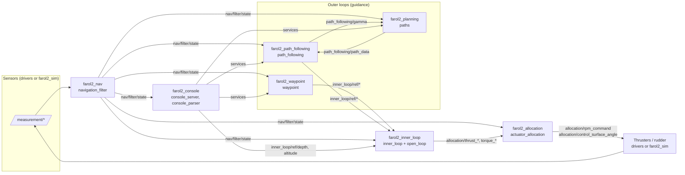

# Architecture

FAROL 2 is the ROS 2 Jazzy port of DSOR's ROS 1 FAROL stack. It runs one set of guidance, navigation and control (GNC) nodes per vehicle, all inside the namespace `/<vehicle_name><vehicle_id>` (for example `/mred0`). Everything described here is the `dev` branch at `693f523`.

## The control chain



1. **Measurements** arrive on `/<ns>/measurement/*` from hardware drivers (separate `farol2_drivers` repository) or from `farol2_sim`.
2. **Navigation** (`farol2_nav`) fuses them into one `farol2_interfaces/NavigationState` on `/<ns>/nav/filter/state`.
3. **Guidance** produces references for the inner loops. Two outer loops exist: `waypoint` (go to a point) and `path_following` (follow a parametric path served by `paths`). Only one is active at a time, arbitrated by the `mission_status` topic.
4. **Inner loops** (`farol2_inner_loop`) are per-degree-of-freedom PID controllers that turn references into body forces and torques, one `std_msgs/Float32` topic per axis.
5. **Allocation** (`farol2_allocation`) maps the body wrench to thruster RPM (and rudder angle for thruster-rudder vehicles) using thruster poses read from TF.
6. **Actuators** (drivers or the simulator) consume `rpm_command` and `control_surface_angle`.
7. **Console** (`farol2_console`) bridges the DSOR web console (HTTP on port 7080) to ROS: it turns mission files into path sections and service calls.

## Mission status

`/<ns>/mission_status` (`std_msgs/Int8`) is the vehicle-mode flag that the ROS 1 docs call *Flag*.

| Value | Meaning | Set by |
|---|---|---|
| 0 | Idle | `waypoint` when a stop waypoint is sent |
| 4 | Waypoint | `waypoint` when a waypoint is accepted |
| 6 | Path following | `path_following` on `Start` |

`path_following` stops itself when the flag changes away from 6. `open_loop` and the thruster-rudder allocation output zero when the flag is 0.

## Namespaces and topic map

All names below are relative to the vehicle namespace `/<ns>`. Every node uses short topic names internally and the package launch file remaps them to these absolute names.

### Measurements (inputs to navigation)

| Topic | Type | Produced by |
|---|---|---|
| `measurement/imu` | `sensor_msgs/Imu` | IMU driver, sim |
| `measurement/gnss` | `sensor_msgs/NavSatFix` | GNSS driver, sim |
| `measurement/ned_utm` | `geometry_msgs/Vector3Stamped` (x = northing, y = easting, z = zone) | sim (publisher commented out) |
| `measurement/velocity_over_ground` | `geometry_msgs/Vector3Stamped` | DVL bottom track (body), GNSS velocity (NED, see [GAPS #4](GAPS.md#4-gnss-velocity-ned-is-treated-as-a-body-frame-velocity-high)) |
| `measurement/velocity_through_water` | `geometry_msgs/Vector3Stamped` | DVL water track, sim |
| `measurement/depth` | `farol2_interfaces/Depth` | depth sensor, sim |
| `measurement/altimeter` | `sensor_msgs/Range` | altimeter driver (not simulated) |
| `measurement/control_surface_angle` | `farol2_interfaces/ControlSurfaceAngle` | rudder feedback, `magic_electric_sim` |
| `measurement/thruster_rpm` | `farol2_interfaces/ThrusterRPM` | thruster feedback |

### Navigation

| Topic | Type | Notes |
|---|---|---|
| `nav/filter/state` | `farol2_interfaces/NavigationState` | Final fused state; every consumer subscribes here |
| `nav/<filter>/state` | `farol2_interfaces/NavigationState` | Intermediate stage outputs when `publish_all_steps` is true |
| `current_estimator/debug`, `yaw_rate_ekf/debug` | `farol2_nav/*Debug` | Filter debug |

### Guidance and references

| Topic | Type | Producer → consumer |
|---|---|---|
| `inner_loop/ref/{surge,sway,heave,depth,altitude}` | `std_msgs/Float32` (m/s, m) | waypoint, path_following, console → inner_loop |
| `inner_loop/ref/{yaw,pitch,roll}` | `std_msgs/Float32` (deg) | waypoint, path_following → inner_loop |
| `inner_loop/ref/{yaw_rate,pitch_rate,roll_rate}` | `std_msgs/Float32` (deg/s) | waypoint, path_following → inner_loop |
| `path_following/path_data` | `farol2_planning/PathData` | paths → path_following |
| `path_following/gamma` | `std_msgs/Float32` | path_following → paths |
| `path_following/virtual_state` | `farol2_interfaces/StateConsole` | paths → console |
| `path_following/vc` | `std_msgs/Float32` | cooperative PF (not on `dev`) → path_following |
| `path_following/debug` | `farol2_path_following/PFDebug` | path_following |
| `current/{x,y}` | `std_msgs/Float32` | path_following (Marcelo current observer) |
| `mission_status` | `std_msgs/Int8` | see above |
| `turn_radius_flag` | `std_msgs/Bool` | (no producer on `dev`) → waypoint |

### Inner loop, allocation, actuators

| Topic | Type | Producer → consumer |
|---|---|---|
| `allocation/{thrust,torque}_{x,y,z}` | `std_msgs/Float32` (N, N·m) | inner_loop → actuator_allocation |
| `inner_loop/pid/<axis>/debug` | `farol2_inner_loop/PidDebug` | inner_loop (when `<axis>.debug`) |
| `allocation/rpm_command` | `farol2_interfaces/ThrusterRPM` | actuator_allocation, open_loop → drivers, sim |
| `allocation/control_surface_angle` | `farol2_interfaces/ControlSurfaceAngle` (deg) | actuator_allocation → magic_electric_sim, drivers |

### Console and simulation

| Topic | Type | Notes |
|---|---|---|
| `addons/Mission_String` | `std_msgs/String` | console_server → console_parser |
| `addons/{path_section,formation,biased_formation,full_mission}` | `farol2_interfaces/Section`, `Formation`, `MultiSection` | console_parser outputs |
| `addons/WPRef` | `geometry_msgs/PointStamped` | console_parser output |
| `State` | `farol2_interfaces/StateConsole` | nav2console_state → console |
| `sim/{position,body_velocity,orientation,orientation_rate,body_acceleration,angular_acceleration}` | ground truth from the simulators |
| `/clock` | `rosgraph_msgs/Clock` | sim_clock (global, not namespaced) |

### Services

| Service | Type | Server |
|---|---|---|
| `waypoint/send_wp_standard`, `send_wp_loose`, `send_wp_heading` | `farol2_waypoint/SendWpType1` | waypoint |
| `path_following/Start`, `Stop` | `farol2_path_following/StartPF`, `StopPF` | path_following |
| `path_following/UpdateGains` | `farol2_path_following/UpdateGainsPF` | path_following |
| `path_following/ResetVT` | `farol2_path_following/ResetVT` | path_following |
| `path_following/Set{Aguiar,Breivik,Fossen,Ilos,Lapierre,Marcelo,Pramod,Ravi,RelativeHeading,Romulo,Samson}` | `farol2_path_following/SetPF` | path_following |
| `ResetPath`, `SetMode` | `farol2_planning/ResetPath`, `SetMode` | paths |
| `Spawn{Arc2D,Bernoulli,Circle2D,Line}Path` | `farol2_planning/Spawn*` | paths |
| `SetConstVdRabbit`, `SetConstVdVehicle` | `farol2_planning/SetConstSpeed` | paths |
| `inner_loop/change_params` | `farol2_inner_loop/ChangeParams` | inner_loop |
| `course_instead_of_yaw` | `std_srvs/SetBool` | inner_loop (the launch file's `course_control` remap does not apply) |
| `current_estimator/tune`, `yaw_rate_ekf/tune` | `farol2_nav/Tune*` | navigation_filter (only when the plugin is loaded) |
| `nav/filter/reset_dead_reckoning` | `std_srvs/Trigger` | none: called by path_following, no server exists |

## Frames, units and conventions

- **World frame**: NED. Horizontal position is UTM (northing, easting, zone) computed from GNSS with GeographicLib. Depth is positive down.
- **Body frame**: `<ns>/base_link`, x forward, y starboard, z down. Thruster, rudder and sensor frames are child links in `farol2_description/urdf/<vehicle>.xacro`, published on `/tf_static` by `robot_state_publisher` with `frame_prefix = <ns>/`.
- **Angles on topics are in degrees** (attitude, references, rudder angles, angular velocity in `NavigationState`). Controllers convert to radians internally.
- **Yaw** is published in [0, 360) deg.
- **Allocation reads TF** for thruster positions and orientations. A thruster always pushes along its own frame's x axis.
- **Time**: simulators run on `/clock` from `sim_clock`; the GNC stack currently runs on wall time even in simulation (see [GAPS #2](GAPS.md#2-simulation-and-stack-run-on-different-clocks-high)).

## Launch structure

```
start_vehicle_sim.launch.py   (farol2_bringup)    start_vehicle_real.launch.py
 ├─ sim_clock.launch.py      (farol2_sim)          ├─ <vehicle>_drivers.launch.py (farol2_drivers_bringup, commented out)
 ├─ farol2_sim.launch.py     (auv_sim | magic_electric_sim)
 └─ start_farol2.launch.py   (farol2_bringup) ◄────┘
      ├─ farol2_nav.launch.py
      ├─ tf_static.launch.py          (farol2_description)
      ├─ farol2_allocation.launch.py
      ├─ farol2_inner_loop.launch.py  (inner_loop, open_loop)
      ├─ farol2_waypoint.launch.py
      ├─ farol2_path_following.launch.py
      ├─ farol2_planning.launch.py
      └─ farol2_console.launch.py     (console_parser, console_server, nav2console_state)
```

Every package launch file takes `vehicle_name`, `vehicle_id`, `use_sim_time` and `config_to_use`, builds the namespace `vehicle_name + vehicle_id`, and loads `farol2_bringup/config/<vehicle_name>/default/<package>.yaml`. See [configuration.md](configuration.md).

When `vehicle_id` is left empty, `farol2_bringup.get_next_available_vehicle_id()` scans the live ROS graph and picks the lowest id not used by any `/<name><id>` namespace, so ids are unique across all vehicle types.

## How FAROL 2 differs from ROS 1 FAROL

| ROS 1 FAROL (`dsor-isr/farol`) | FAROL 2 (`dev`) |
|---|---|
| `farol_bringup` process manager reading `process.yaml` | Plain launch files; `start_farol2.launch.py` is the hand-edited stack definition |
| `#vehicle#` placeholders in topic parameters | Short names remapped in each launch file |
| `filter_handler` + separate filter nodes | One `navigation_filter` node running a filter pipeline |
| `static_thruster_allocation`, `thruster_rudder_allocation`, `rpm_conversion` nodes, thruster geometry in YAML | One `actuator_allocation` node, thruster geometry from TF/URDF |
| `inner_loops_pid` | `farol2_inner_loop` with a reference generator per axis |
| `auv_msgs`, `farol_msgs`, `Flag` topic | `farol2_interfaces`, `mission_status` topic |
| mkdocs site under `docs/` | Per-package `docs/` folders (this set reorganizes them) |
