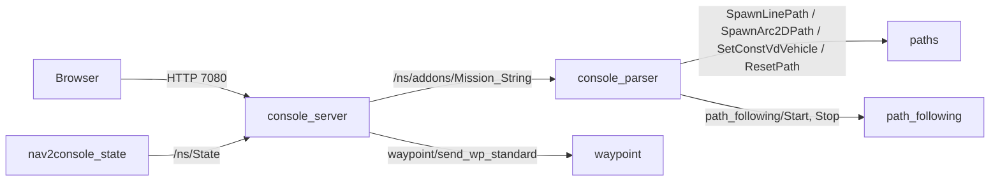

# farol2_console

Bridge between the DSOR web console (a browser front end) and the ROS 2 graph. Three nodes, all launched by `farol2_console.launch.py` in `/<ns>/addons`, with parameters from `addons.yaml`.

| Node | Executable | Language | Role |
|---|---|---|---|
| `console_server` | `console_server` | Python | HTTP server on `PORT` (7080). Serves the console pages and lets the browser read and publish topics |
| `console_parser` | `console_parser_node` | C++ | Turns a mission text received on `Mission_String` into planning service calls and starts path following |
| `nav2console_state` | `nav2console_state_node` | C++ | Republishes `nav/filter/state` as the flat `StateConsole` message the console draws |



## console_server

A `ThreadingMixIn` HTTP server, ported from the ROS 1 `rostopic`-based console.

| Request | What it does |
|---|---|
| `GET /` or `/index*` | Serves `index.html` from `pages_folder` |
| `GET *.js`, `*.css` | Serves that file from `pages_folder` |
| `GET /VAR <topic> <topic> ...` | Subscribes to each topic on first request and returns the latest values as XML |
| `GET /RSET <topic> <yaml>\|...` | Publishes on one or more topics (`ros2 topic pub`-style); `Mission_String` sends a mission to `console_parser`, and waypoint requests go to `waypoint/send_wp_standard` |
| `POST` (form field `upfile`) | Saves an uploaded mission file to the mission folder and returns the mission list |

| Parameter | Default | Notes |
|---|---|---|
| `PORT` | 7080 | |
| `root_namespace` | (in `addons.yaml`: true) | |
| `pages_folder` | `/home/farol/farol-sw/farol_common/http_server/pages/` | Hard-coded; the pages are not in this repository ([GAPS #33](../../GAPS.md#33-console-pages-are-not-shipped-low)) |
| `addons.console_parser.path_folder` | `~/paths_from_console` | Mission folder; differs from the parser's ([GAPS #32](../../GAPS.md#32-console-server-and-parser-use-different-mission-folders-medium)) |

The script still contains ROS 1 helpers (`rosgraph`, `rostopic` name resolution) in functions that nothing calls, and uses the `cgi` module, which is removed in Python 3.13.

## console_parser

On each `Mission_String` message it parses the mission, resets the path, spawns one planning section and one speed section per mission line, calls `path_following/Start`, and saves the mission text as `<path_folder>/<YYYY-MM-DD_HH-MM-SS>.txt`.

### Mission format (version 3)

```text
3                                   # line 1: version, must be 3
<x_ref> <y_ref> <name>              # line 2: reference point, easting and northing (UTM, m)
LINE  xi yi xe ye velocity [vehicle] [gamma_e]
ARC   xi yi xc yc xe ye velocity direction radius [vehicle] [gamma_e]
POINT xe ye radius velocity heading time vehicle
DEPTH depth time vehicle
ALT   altitude time vehicle
FORMATION ...                       # cooperative missions
# lines starting with '#' are ignored
```

Section coordinates are offsets from the reference point (`x` east, `y` north); the parser converts them to the planning service's `[north, east]` order. `vehicle` is the target vehicle id, `-1` for all. Only `LINE` and `ARC` become a path. `POINT` publishes `addons/WPRef` and `FORMATION` publishes `addons/formation`, which nothing in the stack subscribes to, so they have no effect. `DEPTH` and `ALT` publish `inner_loop/ref/depth` and `inner_loop/ref/altitude` while the section runs.

### Interfaces

| Direction | Name | Type |
|---|---|---|
| sub | `addons/Mission_String` | `std_msgs/String` |
| sub | `nav/filter/state` | `farol2_interfaces/NavigationState` |
| sub | `mission_status` | `std_msgs/Int8` |
| pub | `addons/{path_section, formation, biased_formation, WPRef, full_mission}` | `Section`, `Formation`, `Formation`, `geometry_msgs/PointStamped`, `MultiSection` |
| pub | `inner_loop/ref/depth`, `inner_loop/ref/altitude` | `std_msgs/Float32` |
| client | `ResetPath`, `SpawnLinePath`, `SpawnArc2DPath`, `SetConstVdVehicle`, `path_following/Start`, `path_following/Stop` | planning and path-following services |

| Parameter | `addons.yaml` | Notes |
|---|---|---|
| `node_frequency` | 5.0 | |
| `path_folder` | `../paths_from_console` | Relative to the process working directory |
| `vehicle_id` | 3 | The same for every vehicle, so per-vehicle sections are wrong for all but id 3 ([GAPS #18](../../GAPS.md#18-console_parser-vehicle-id-is-hard-coded-to-3-medium)) |
| `console_new` | false | Intended to zero the reference point; currently overwritten right after |

## nav2console_state

Subscribes to `nav/filter/state` and publishes `farol2_interfaces/StateConsole` on `/<ns>/State`: `x` easting, `y` northing, `z` and `depth` from depth, attitude and rates in degrees, `gps_good` and `imu_good` fixed at 3.

## Build note

`console_parser` includes Boost headers that `package.xml` and `CMakeLists.txt` do not declare; install `libboost-dev` ([GAPS #17](../../GAPS.md#17-undeclared-boost-dependency-in-farol2_console-medium)).

## Known gaps

[#17](../../GAPS.md#17-undeclared-boost-dependency-in-farol2_console-medium), [#18](../../GAPS.md#18-console_parser-vehicle-id-is-hard-coded-to-3-medium), [#32](../../GAPS.md#32-console-server-and-parser-use-different-mission-folders-medium), [#33](../../GAPS.md#33-console-pages-are-not-shipped-low).
