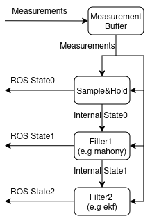

# farol2_nav

Navigation estimation. One node, `navigation_filter` (executable `filter_node`), runs a fixed-rate pipeline of filter plugins over a shared state and publishes one `farol2_interfaces/NavigationState`.

## How it works

1. Each subscribed measurement topic stores its latest message in a `MeasurementSnapshot` (one slot per type).
2. On every timer tick (`node_frequency`), the state is reset and the pipeline runs in order:
   - `sample_and_hold` always runs first. It copies sensor values into the state, applying the static `base_link ← sensor` transform from TF (lever arm and rotation). Until every measurement in `plugins.sample_and_hold.initializer_measurements` has arrived once, nothing is published.
   - Each name in `filters` adds one plugin after it.
3. Intermediate states go to `<filter>/state` when `publish_all_steps` is true; the final state always goes to `state`.
4. The snapshot is cleared, so the next tick only sees new messages. There is no per-sensor timeout.

### Plugins

| Key | Class | What it estimates | Page |
|---|---|---|---|
| (implicit) `sample_and_hold` | `SampleAndHoldFilter` | Pass-through of all sensors, UTM from GNSS, lever-arm compensation | [sample_and_hold.md](sample_and_hold.md) |
| `asv_dynamics_model` | `AsvDynamicsModelFilter` | Surge, sway and yaw rate (u, v, r) through water from a surface-vessel model driven by thruster RPM and rudder angle; writes `velocity_through_water` | (no page yet; parameters below) |
| `current_estimator` | `CurrentEstimatorFilter` | 4-state Kalman filter `[x, y, current_x, current_y]` using water-relative velocity and GNSS position; writes `current_velocity_ned` | [current_estimator.md](current_estimator.md) |
| `yaw_rate_ekf` | `YawRateEkfFilter` | Yaw rate, yaw, torque bias and torque gain from a yaw-dynamics model | [yaw_rate_ekf.md](yaw_rate_ekf.md) |

Order matters: `current_estimator` needs `velocity_through_water`, so put `asv_dynamics_model` (or a DVL water-track measurement) before it.

### Adding a plugin

1. Implement `farol2_nav::filters::BaseFilter` (`name`, `configure`, `compute`, optionally `initialized`).
2. Add it to `src/filters/` and the `CMakeLists.txt` library.
3. Add an `else if (key == "<name>")` branch in `FilterNode::build_pipeline()`.
4. Add a `('<name>/state', '/<ns>/nav/<name>/state')` remap in `launch/farol2_nav.launch.py` (ROS 2 remaps have no wildcards).
5. Add `plugins.<name>.*` to the vehicles' `nav.yaml`.

## Topics

Names are relative to `/<ns>`.

| Direction | Topic | Type | Enabled by `measurements` entry |
|---|---|---|---|
| sub | `measurement/imu` | `sensor_msgs/Imu` | `imu` |
| sub | `measurement/gnss` | `sensor_msgs/NavSatFix` | `gnss` |
| sub | `measurement/ned_utm` | `geometry_msgs/Vector3Stamped` | `utm_ned` (note the different spelling) |
| sub | `measurement/velocity_over_ground` | `geometry_msgs/Vector3Stamped` | `velocity_over_ground` |
| sub | `measurement/velocity_through_water` | `geometry_msgs/Vector3Stamped` | `velocity_through_water` |
| sub | `measurement/depth` | `farol2_interfaces/Depth` | `depth` |
| sub | `measurement/altimeter` | `sensor_msgs/Range` | `altimeter` |
| sub | `measurement/control_surface_angle` | `farol2_interfaces/ControlSurfaceAngle` | `control_surface_angle` |
| sub | `measurement/thruster_rpm` | `farol2_interfaces/ThrusterRPM` | `thruster_rpm` |
| pub | `nav/filter/state` | `farol2_interfaces/NavigationState` | |
| pub | `nav/<filter>/state` | `farol2_interfaces/NavigationState` | `publish_all_steps` |
| pub | `current_estimator/debug` | `farol2_nav/CurrentEstimatorDebug` | plugin loaded |
| pub | `yaw_rate_ekf/debug` | `farol2_nav/YawRateEkfDebug` | plugin loaded |
| pub | `asv_dynamics_model/uvr`, `asv_dynamics_model/tau` | `geometry_msgs/Vector3` | plugin loaded |

The launch file also remaps `current_velocity` and `altitude`, which no code subscribes to.

## Services

| Service | Type | Notes |
|---|---|---|
| `current_estimator/tune` | `farol2_nav/TuneCurrentEstimator` | Change Q/R online |
| `yaw_rate_ekf/tune` | `farol2_nav/TuneYawRateEkf` | Change Q/R online |

## Parameters

YAML key must be the node name `navigation_filter` (the shipped YAML uses `filter_node` and is ignored, [GAPS #1](../../GAPS.md#1-every-vehicles-navyaml-is-silently-ignored-high)).

| Parameter | Type | Default | Meaning |
|---|---|---|---|
| `node_frequency` | double | 10.0 | Pipeline rate (Hz) |
| `publish_all_steps` | bool | true | Publish intermediate states |
| `measurements` | string[] | `[gnss, imu]` | Topics to subscribe to |
| `filters` | string[] | `[]` | Plugins after `sample_and_hold`; `""` entries are skipped |
| `frame_prefix` | string | set by launch | `<ns>/`, prefixed to `base_link` for TF lookups |
| `plugins.sample_and_hold.initializer_measurements` | string[] | = `measurements` | Must all arrive once before publishing |
| `plugins.current_estimator.{process_noise_pos, process_noise_current, measurement_noise_pos, init_cov_pos, init_cov_current, init_current_speed, init_current_direction}` | double | 0.1, 0.01, 1.0, 25.0, 1.0, 0.0, 0.0 | Other keys in the example YAML are not read |
| `plugins.yaw_rate_ekf.*` | double/int | see `yaw_rate_ekf.cpp:38-70` | Noise terms, initial covariances, `inertia`, `m_uv`, `damping`, `damping_quadratic`, `torque_gain`, `rudder_arm`, `K_L`, `K_D0`, `K_D1`, `measurement_window_samples`, `yaw_measurement_window_samples` |
| `plugins.asv_dynamics_model.*` | double | see `asv_dynamics_model.cpp:21-62` | Propeller (`rho`, `prop_pitch`, `prop_diameter`, `k_t_bp`, RPM limits and rate limit), hull (`m_u`, `m_uv`, `x_u`, `x_uu`, `Y_v`, `Y_vv`, `m_r`, `damping`, `damping_quadratic`), rudder (`rudder_arm`, `control_surface_angle_limit_deg`, `K_L`, `K_D0`, `K_D1`, `torque_bias`), initial `u, v, r` |

## Output conventions

`NavigationState` angles and angular rates are in degrees; yaw is wrapped to [0, 360). `velocity_over_ground` and `velocity_through_water` are body-frame vectors. `course_over_ground` is not computed yet ([GAPS #14](../../GAPS.md#14-course_over_ground-is-never-computed-medium)).

## Known gaps

[#1](../../GAPS.md#1-every-vehicles-navyaml-is-silently-ignored-high), [#2](../../GAPS.md#2-simulation-and-stack-run-on-different-clocks-high) (wall timer), [#4](../../GAPS.md#4-gnss-velocity-ned-is-treated-as-a-body-frame-velocity-high), [#10](../../GAPS.md#10-reset_dead_reckoning-service-has-no-server-medium), [#14](../../GAPS.md#14-course_over_ground-is-never-computed-medium), [#21](../../GAPS.md#21-undeclared-filter_node-launch-argument-low), [#22](../../GAPS.md#22-example-navyaml-documents-parameters-the-code-does-not-read-low), [#40](../../GAPS.md#40-driver-frame-ids-do-not-match-the-urdf-medium).
