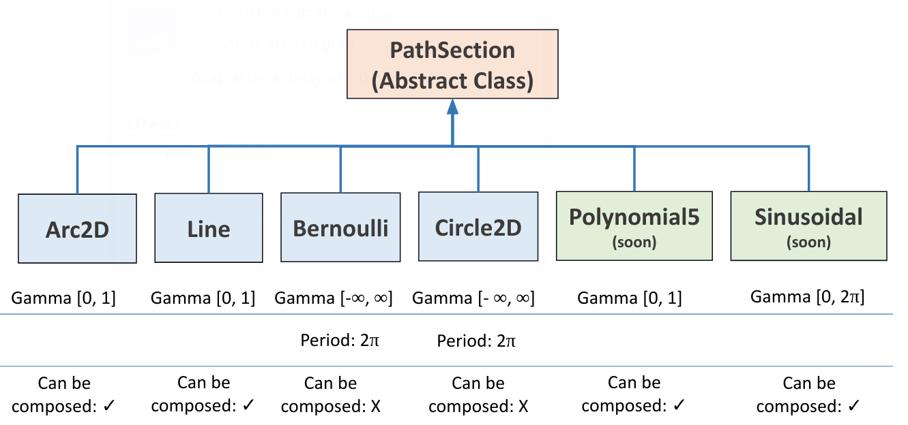

# farol2_planning

Path generation. One node, `paths` (executable `path_node`), stores a path parameterised by γ and, at a fixed rate, publishes the path point, its derivatives, curvature and desired speed for `farol2_path_following`. The class design (`Path`, `PathSection`, `Speed`) is explained in [implementation.md](implementation.md).



## How it works

1. A path is built by calling the spawn services. Sections are appended in order.
   - **Composable** sections (`Line`, `Arc2D`) can be chained: γ starts at 0 and each section adds its own γ range.
   - **Simple** sections (`Circle2D`, `Bernoulli`) cannot be chained: they must be the only section, and γ is unbounded.
2. A speed profile is added with `SetConstVdVehicle` (m/s along the path) or `SetConstVdRabbit` (constant γ̇).
3. On each tick at `node_frequency`, the node evaluates the path at the current γ and publishes `PathData` plus the virtual-target position.
   - In **gamma mode** (default), γ comes from `path_following/gamma`, published by virtual-target path-following laws.
   - In **closest-point mode** (`SetMode` with `closest_point_mode: true`), γ is the point on the path closest to the vehicle position.
4. `ResetPath` deletes the path and returns to gamma mode. `farol2_path_following` calls it when a mission stops.

Coordinates are `[north, east, z]` in UTM metres (absolute, not relative to a local origin).

## Topics

Names are relative to `/<ns>`.

| Direction | Topic | Type |
|---|---|---|
| sub | `path_following/gamma` | `std_msgs/Float32` |
| sub | `nav/filter/state` | `farol2_interfaces/NavigationState` |
| pub | `path_following/path_data` | `farol2_planning/PathData` |
| pub | `path_following/virtual_state` | `farol2_interfaces/StateConsole` (virtual target for the console; `x` east, `y` north, `yaw` in deg) |

### PathData

| Field | Meaning |
|---|---|
| `gamma` | γ used for this sample |
| `pd`, `d_pd`, `dd_pd` | Path position and its first and second derivatives w.r.t. γ |
| `curvature`, `tangent`, `derivative_norm` | Curvature, tangent angle (rad), ‖∂pd/∂γ‖ |
| `vd`, `d_vd` | Desired γ̇ and its derivative |
| `vehicle_speed` | `vd · derivative_norm` (m/s) |
| `gamma_min`, `gamma_max` | Valid γ range of the whole path |
| `reset_path` | Not set by the node |

## Services

All live directly under `/<ns>` (not `/<ns>/planning`).

| Service | Type | Request | Notes |
|---|---|---|---|
| `SpawnLinePath` | `SpawnLine` | `start_point[3]`, `end_point[3]`, `ref_point[3]` | Composable. Rejected if start = end. `ref_point` is stored but not used ([GAPS #23](../../GAPS.md#23-planning-stubs-low)) |
| `SpawnArc2DPath` | `SpawnArc2D` | `start_point[2]`, `end_point[2]`, `center_point[2]`, `direction` (int8), `z` | Composable. Rejected if any two points coincide |
| `SpawnCircle2DPath` | `SpawnCircle2D` | `radius`, `center_x`, `center_y`, `z` | Simple. Rejected if `radius <= 0` |
| `SpawnBernoulliPath` | `SpawnBernoulli` | `radius`, `center_x`, `center_y`, `z` | Simple (lemniscate). Rejected if `radius <= 0` |
| `SetConstVdVehicle` | `SetConstSpeed` | `speed` (m/s), `default_speed` | Constant vehicle speed along the path |
| `SetConstVdRabbit` | `SetConstSpeed` | `speed`, `default_speed` | Constant γ̇ for the virtual target |
| `SetMode` | `SetMode` | `closest_point_mode` (bool) | Switch between gamma and closest-point mode |
| `ResetPath` | `ResetPath` | empty | Delete the path, clear γ, back to gamma mode |

Every service returns `bool success`. A rejected section still returns a response, with `success: false`.

`Sinusoid2D` and `Polynomial5` sections exist in the source but have no service and incomplete equations ([GAPS #23](../../GAPS.md#23-planning-stubs-low)).

## Parameters

| Parameter | Type | Meaning |
|---|---|---|
| `node_frequency` | double | Publication rate (Hz) |
| `frame_id` | string | `header.frame_id` of `PathData` (`Path_frame` in all vehicle YAMLs) |

Both are required.

## Example

```bash
ns=/mred0
ros2 service call $ns/SpawnLinePath farol2_planning/srv/SpawnLine \
  "{start_point: [4290800.0, 491900.0, 0.0], end_point: [4290900.0, 491900.0, 0.0], ref_point: [0.0, 0.0, 0.0]}"
ros2 service call $ns/SetConstVdVehicle farol2_planning/srv/SetConstSpeed "{speed: 0.5, default_speed: 0.5}"
ros2 service call $ns/path_following/Start farol2_path_following/srv/StartPF
```

See [getting-started.md](../../getting-started.md) for a full mission.

## Known gaps

[#23](../../GAPS.md#23-planning-stubs-low). The service pages in the repository's `docs/` (`SpawnLine.md` and others) still use ROS 1 `farol_msgs` names.
