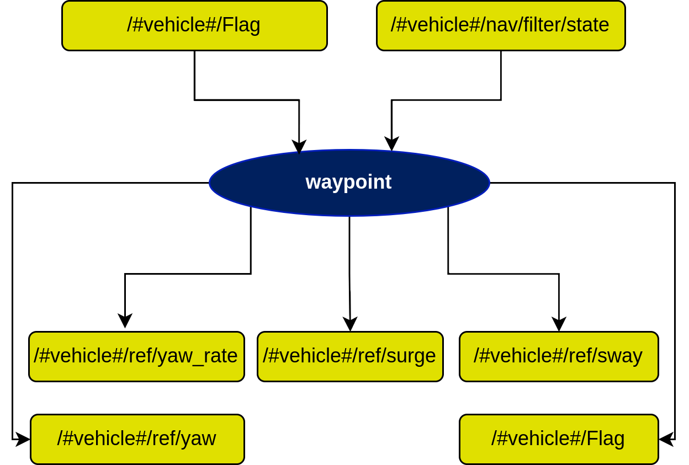

# farol2_waypoint

Waypoint outer loop. One node, `waypoint` (executable `waypoint_node`), drives the vehicle to a single UTM point with one of three controllers and owns the `mission_status = 4` state.



## mission_status

`mission_status` (`std_msgs/Int8`, `/<ns>/mission_status`) is the global vehicle state. In ROS 1 FAROL it was called `Flag`.

| Value | State | Set by |
|---|---|---|
| 0 | Idle | `waypoint` (stop request), console, user |
| 4 | Waypoint | `waypoint` when a request is accepted |
| 6 | Path following | `path_following/Start` |

`waypoint` stops its timer when any other node publishes a value other than 4. `actuator_allocation` in `thrust_rudder` mode and `open_loop` stop commanding the actuators at 0.

## Services

All three use `farol2_waypoint/SendWpType1` (`float32 x, y, yaw` → `bool success, string message`). `x` is the UTM **northing** and `y` the **easting**, in metres ([GAPS #30](../../GAPS.md#30-waypoint-coordinates-are-float32-medium) on precision).

| Service | Controller | References published |
|---|---|---|
| `waypoint/send_wp_standard` | `WpStandard` | `inner_loop/ref/surge`, `inner_loop/ref/yaw` |
| `waypoint/send_wp_loose` | `WpLoose` | `inner_loop/ref/surge`, `inner_loop/ref/yaw` (yaw reference rate-limited to `speed_turn` deg/s) |
| `waypoint/send_wp_heading` | `WpHeading` | `inner_loop/ref/surge`, `inner_loop/ref/sway`, `inner_loop/ref/yaw_rate` (holds `yaw` at the point; for fully actuated vehicles) |

Special `(x, y)` values:

| `(x, y)` | Meaning |
|---|---|
| `(-1, -1)` | Hold the current position |
| `(-2, -2)` | Stop: publish `mission_status = 0` and stop the timer (`success` is false, message "Stop signal sent") |
| `(-3, -3)` | Go to a point `delta_t` seconds ahead along the current heading at the current surge speed (used by `path_following` at the end of a path) |

```bash
ros2 service call /mred0/waypoint/send_wp_standard farol2_waypoint/srv/SendWpType1 "{x: 4290850.0, y: 491920.0, yaw: 0.0}"
```

## Control laws

Let `d` be the distance to the waypoint.

- **Standard and loose**: yaw reference is the bearing to the point. While `d > cdist`, `u_ref = ku · asin((d − cdist)/(|d − cdist| + ks)) · 2/π`, scaled down by a tanh factor of the yaw error (full speed when aligned, near zero beyond about 60°). With `turn_radius_flag` true, standard mode uses a fixed 0.5 factor instead. Inside `cdist`, surge is 0 and yaw is held.
  - **Standard currently ignores this and always publishes 0.3 m/s surge** ([GAPS #36](../../GAPS.md#36-standard-waypoint-never-stops-the-vehicle-high)).
- **Heading**: the position error is rotated to the body frame and saturated with tanh, then `[u_ref, v_ref] = −diag(k1, k2) · e_body` while `d > cdist`; `r_ref = −k3 · wrap(yaw − yaw_ref)`.

## Topics

| Direction | Topic | Type |
|---|---|---|
| sub | `nav/filter/state` | `farol2_interfaces/NavigationState` (uses UTM, yaw and body velocity) |
| sub / pub | `mission_status` | `std_msgs/Int8` |
| sub | `turn_radius_flag` | `std_msgs/Bool` (no publisher in the stack) |
| pub | `inner_loop/ref/{surge,sway,yaw,yaw_rate}` | `std_msgs/Float32` |

## Parameters

All are required.

| Parameter | Example (`mred`) | Meaning |
|---|---|---|
| `node_frequency` | 10.0 | Controller rate (Hz) |
| `cdist` | 1.5 | Arrival radius (m) |
| `delta_t` | 5.0 | Look-ahead time for `(-3, -3)` (s) |
| `type1.gains.ku`, `ks` | 1.0, 4.0 | Surge gain and shaping for standard and loose |
| `type1.gains.speed_turn` | 5.0 | Max yaw-reference rate for loose (deg/s) |
| `type2.gains.k1`, `k2`, `k3` | 0.05, 0.1, 0.1 | Surge, sway and yaw-rate gains for heading |

The node is launched in `/<ns>` (not `/<ns>/waypoint`), so its parameters are `/<ns>/waypoint`.

## Known gaps

[#30](../../GAPS.md#30-waypoint-coordinates-are-float32-medium), [#31](../../GAPS.md#31-waypoint-controller-leak-low), [#36](../../GAPS.md#36-standard-waypoint-never-stops-the-vehicle-high).
