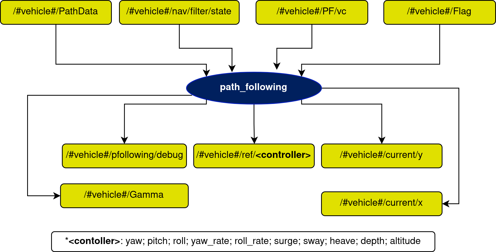

# path\_following Node

## In a nutshell
The `path_following` node (executable `path_following_node`, ROS node name `path_following`) runs the selected path-following algorithm on the path published by the [paths node](../../farol2_planning/docs/paths.md) and publishes references to the inner loops. The algorithms are described in the [implementation](implementation.md) page and in this [paper](https://arxiv.org/abs/2204.07319).



Names are relative to the vehicle namespace `/<vehicle_name><vehicle_id>/` and are remapped in `launch/farol2_path_following.launch.py`.

## Subscribers
| Topic | Type | Purpose |
| --- | --- | --- |
| `nav/filter/state` | `farol2_interfaces/NavigationState` | Filtered state of the vehicle. |
| `path_following/path_data` | `farol2_planning/PathData` | Path information from the paths node. |
| `path_following/vc` | `std_msgs/Float32` | Velocity correction from a coordination (CPF) node, if deployed. |
| `mission_status` | `std_msgs/Int8` | Vehicle mode (0 idle, 4 waypoint, 6 path following). |

## Publishers
| Topic | Type | Purpose |
| --- | --- | --- |
| `path_following/gamma` | `std_msgs/Float32` | Progression along the path parameter (virtual target). |
| `path_following/debug` | `farol2_path_following/PFDebug` | Debug data. |
| `current/x`, `current/y` | `std_msgs/Float32` | Estimated current components (algorithms that observe currents). |
| `inner_loop/ref/surge`, `sway`, `yaw`, `yaw_rate` | `std_msgs/Float32` | References for the inner loop (yaw in degrees, rates in deg/s). |
| `mission_status` | `std_msgs/Int8` | Set to 6 on `Start`, 0 on `Stop`. |

## Services
| Service | Type | Purpose |
| --- | --- | --- |
| `path_following/Start` | [StartPF](StartPF.md) | Run the previously configured path following. |
| `path_following/Stop` | [StopPF](StopPF.md) | Stop it (also resets the path). |
| `path_following/UpdateGains` | [UpdateGainsPF](UpdateGainsPF.md) | Update gains in real time (`float64[] gains`, order depends on the algorithm). |
| `path_following/ResetVT` | [ResetVT](ResetVT.md) | Reset the virtual target. |
| `path_following/Set<Algorithm>` | [SetPF](SetPF.md) | Select the algorithm: `SetLapierre`, `SetAguiar`, `SetBreivik`, `SetFossen`, `SetIlos`, `SetMarcelo`, `SetPramod`, `SetRavi`, `SetRomulo`, `SetSamson`, `SetRelativeHeading`. |
| `ResetPath`, `SetMode` | planning services | Forwarded to the paths node (clients). |
| `waypoint/send_wp_standard` | `farol2_waypoint/SendWpType1` | Client: used to send a waypoint at the end of the path. |
| `nav/filter/reset_dead_reckoning` | | Client of the navigation reset. |

A worked example (spawn a line, select Breivik, start) is in [docs/runbook.md](../../docs/runbook.md).

## Parameters
Defined in `farol2_bringup/config/<vehicle>/default/path_following.yaml`:

```yaml
/**:
  path_following:
    ros__parameters:
      node_frequency: 10.0
      default_algorithm: breivik       # algorithm used before any Set<Algo> call
      controller_gains:
        <algorithm>:
          <gain>: <value>
```

Which algorithms have a gain block depends on the vehicle: `bluerov`, `delfim`, `mblack`, `mred` and `myellow` define `lapierre, marcelo, aguiar, romulo, pramod, ravi, samson, relative_heading, breivik`; `magicelectric` defines only `ravi, pramod, breivik, ilos` (default `ravi`). `fossen` is defined in no vehicle file and `ilos` only in `magicelectric`. Calling `Set<Algo>` for an algorithm without its `controller_gains.<algo>` block makes the node read an undeclared parameter, so add the block first. `farol2_path_following/config/path_following.yaml` is an unused example (it is not installed).

### Lapierre Algorithm
| Parameters | type | Default |
| --- | --- | --- |
| k1 | float | 1.0 |
| k2 | float | 0.3 |
| k3 | float | 0.3 |
| theta | float | 0.8 |
| k\_delta | float | 1.0 |

### Marcelo Algorithm
| Parameters | type | Default |
| --- | --- | --- |
| delta | float | -1.0 |
| kx | float | 0.5 |
| ky | float | 0.5 |
| kz | float | 0.5 |
| k\_pos | float | 2.0 |
| k\_currents | float | 0.2 |
| rd | array | [0.0, 0.0, 1.0] |
| d | array | [0.0, 0.0, 0.0] |

### Aguiar Algorithm
| Parameters | type | Default |
| --- | --- | --- |
| delta | float | -1.0 |
| kx | float | 0.5 |
| ky | float | 0.5 |
| kz | float | 0.5 |
| k\_pos | float | 0.5 |
| k\_currents | float | 0.5 |

### Romulo Algorithm
| Parameters | type | Default |
| --- | --- | --- |
| ke | array | [0.05, 0.0, 0.0, 0.05] |
| kz | float | 0.2 |

### Pramod Algorithm
| Parameters | type | Default |
| --- | --- | --- |
| kp | float | 0.02 |
| ki | float | 0.0005 |

### Ravi Algorithm
| Parameters | type | Default |
| --- | --- | --- |
| e_turn | float | 45.0 |
| min_corridor | float | 45.0 (5.0 on magicelectric) |
| xi | float | 1.0 |
| w0_min | float | 0.08 |
| epsilon_current | float | 0.2 |

### Samson Algorithm
| Parameters | type | Default |
| --- | --- | --- |
| k1 | float | 1.0 |
| k2 | float | 0.3 |
| k3 | float | 0.3 |
| theta | float | 0.8 |
| k\_delta | float | 1.0 |

### Relative Heading Algorithm
| Parameters | type | Default |
| --- | --- | --- |
| kx | float | 0.5 |
| ky | float | 0.1 |
| kz | float | 0.2 |
| yaw\_offset | float | 0.785 |
| p\_sat | array | [1.0, 1.0] |

### Breivik Algorithm
| Parameters | type | Default |
| --- | --- | --- |
| delta\_h | float | 10.0 |

### ILOS Algorithm (magicelectric only)
| Parameters | type | Default |
| --- | --- | --- |
| delta | float | 10.0 (lookahead, m) |
| ki | float | 0.05 |

### General Parameters
| Parameters | type | Default | Purpose |
| --- | --- | --- | --- |
| node\_frequency | float | 10.0 | Working frequency of the node |