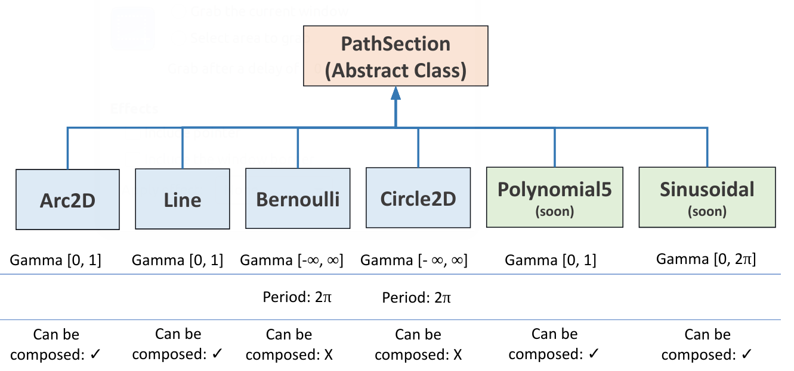

# paths Node

The `paths` node (executable `path_node`, ROS node name `paths`, namespace `/<ns>/planning`) manages and deploys the path that the vehicle follows. A detailed explanation of the path representation is in [implementation](implementation.md).

Names below are relative to the vehicle namespace `/<vehicle_name><vehicle_id>/` (for example `/delfim0/`) and are remapped in `launch/farol2_planning.launch.py`.

## Subscribers
| Topic | Type | Purpose |
| --- | --- | --- |
| `path_following/gamma` | `std_msgs/Float32` | Path parameter (progress) published by `path_following`, or by a coordination node when `SetMode` is false. |
| `nav/filter/state` | `farol2_interfaces/NavigationState` | Filtered vehicle state, used to find the closest point on the path. |

## Publishers
| Topic | Type | Purpose |
| --- | --- | --- |
| `path_following/path_data` | [farol2_planning/PathData](PathData.md) | Path data at the current point (position, derivatives, curvature, tangent, desired speeds). |
| `path_following/virtual_state` | `farol2_interfaces/StateConsole` | State of the virtual target (rabbit), for the console. |

## Services
| Service | Type | Purpose |
| --- | --- | --- |
| `ResetPath` | [ResetPath](ResetPath.md) | Reset the current path. |
| `SetConstVdRabbit` | [SetConstSpeed](SetConstSpeed.md) | Constant speed for the virtual target. |
| `SetConstVdVehicle` | [SetConstSpeed](SetConstSpeed.md) | Constant desired speed for the vehicle. |
| `SetMode` | [SetMode](SetMode.md) | `closest_point_mode: true` computes the closest point to the path; false takes the path parameter from an external `gamma`. |
| `SpawnArc2DPath` | [SpawnArc2D](SpawnArc2D.md) | Append a 2D circle arc. |
| `SpawnBernoulliPath` | [SpawnBernoulli](SpawnBernoulli.md) | Append a lemniscate of Bernoulli. |
| `SpawnCircle2DPath` | [SpawnCircle2D](SpawnCircle2D.md) | Append a 2D circle. |
| `SpawnLinePath` | [SpawnLine](SpawnLine.md) | Append a line segment. |

Path coordinates are UTM `[northing, easting, z]` in metres. Spawning appends a section to the current path; call `ResetPath` first for a new one. `path_following/Stop` also resets the path.

## Parameters
In `farol2_bringup/config/<vehicle>/default/planning.yaml`, under `/**: paths: ros__parameters:`.

| Parameter | Type | Default | Purpose |
| --- | --- | --- | --- |
| `frame_id` | string | `Path_frame` | Frame assigned to the path data. |
| `node_frequency` | double | 10.0 | Working frequency. |

## Not implemented
`Polynomial5.cpp` and `Sinusoid2D.cpp` are empty TODO stubs, and `include/algorithms/path_sections/Polinomial5.h` is a misspelled duplicate of `Polynomial5.h`. There is no service for those sections.
