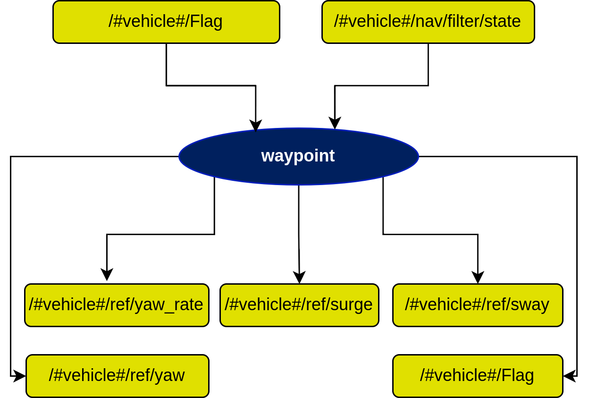

# waypoint node

## In a nutshell
The `waypoint` node (executable `waypoint_node`, ROS node name `waypoint`) takes the filtered vehicle state and, once a waypoint is requested through one of its services, publishes the inner-loop references that make the vehicle converge to it. A 10 Hz timer (`node_frequency`) runs the selected controller; the timer is only active while `mission_status == 4`.

All names below are relative to the vehicle namespace `/<vehicle_name><vehicle_id>/` (for example `/delfim0/`). They are remapped in `launch/farol2_waypoint.launch.py`.

## Subscribers
| Topic | Type | Purpose |
| --- | --- | --- |
| `mission_status` | `std_msgs/Int8` | Vehicle mode (see [README](README.md)). If it changes to a value other than 4 the timer is cancelled. |
| `nav/filter/state` | `farol2_interfaces/NavigationState` | Filtered state. The node uses `utm_position.northing/easting`, `attitude.yaw` (deg) and `velocity_over_ground.x/y`. |
| `turn_radius_flag` | `std_msgs/Bool` | When true the loose/heading controller limits the turn rate. |

## Publishers
| Topic | Type | Purpose |
| --- | --- | --- |
| `inner_loop/ref/surge` | `std_msgs/Float32` | Surge reference (m/s). |
| `inner_loop/ref/sway` | `std_msgs/Float32` | Sway reference (m/s), heading controller only. |
| `inner_loop/ref/yaw` | `std_msgs/Float32` | Yaw reference (deg). |
| `inner_loop/ref/yaw_rate` | `std_msgs/Float32` | Yaw-rate reference (deg/s), heading controller. |
| `mission_status` | `std_msgs/Int8` | Set to 4 when a waypoint is accepted, 0 on stop. |

## Services
All are `farol2_waypoint/srv/SendWpType1` (see [sendWpType1](sendWpType1.md)).

| Service | Purpose |
| --- | --- |
| `waypoint/send_wp_standard` | Go to (x, y). |
| `waypoint/send_wp_loose` | Go to (x, y) limiting the yaw rate to `type1.gains.speed_turn` for wider turns. |
| `waypoint/send_wp_heading` | Go to (x, y) and finish with a given yaw. |

`x` is the UTM **northing** and `y` the UTM **easting** (metres). Special values: `(-1,-1)` hold position, `(-3,-3)` aim `delta_t` seconds ahead along the current heading, `(-2,-2)` stop (the response then has `success: False` and `message: 'Stop signal sent'`).

## Parameters
Defined in `farol2_bringup/config/<vehicle>/default/waypoint.yaml`, under `/**: waypoint: ros__parameters:`.

| Parameter | Type | Default (delfim) | Purpose |
| --- | --- | --- | --- |
| `node_frequency` | double | 10.0 | Controller rate (Hz). |
| `cdist` | double | 1.5 | Distance (m) at which the waypoint is considered reached. |
| `delta_t` | double | 5.0 | Look-ahead time (s) for the `(-3,-3)` special waypoint. |
| `type1.gains.ku` | double | 1.0 | `u` gain, standard and loose controllers. |
| `type1.gains.ks` | double | 4.0 | `s` gain, standard and loose controllers. |
| `type1.gains.speed_turn` | double | 5.0 | Yaw-rate saturation for the loose waypoint turn. |
| `type2.gains.k1`, `k2`, `k3` | double | 0.05, 0.1, 0.1 | Gains of the heading controller (`send_wp_heading`). |

All parameters are declared without a default in the code: a missing key makes the node fail at start-up.

## Known limitations
- `x` and `y` are `float32`; at UTM magnitudes (about 4e6 m) the resolution is 0.25 m.
- The previous controller object is not freed when a new waypoint is sent (the `free` is commented out in `createWaypoint`).
- On the stop request the response `success` field is left false.
